# Fine-tuning

---

<aside>
📋

- **Plan**
</aside>

---

## 1. Objectif

Le fine-tuning constitue la première approche mise en œuvre. Les éléments qui suivent (transformation des données en paires question / réponse, découpage entraînement / validation / test, apprentissage d'adaptateurs LoRA) lui sont **propres** : ils ne s'appliquent ni à l'ingénierie de prompt, ni au RAG, qui n'exigent aucun entraînement.

Deux modèles sont affinés séparément, un par tâche. Cette séparation évite qu'un modèle unique ait à distinguer deux formats de sortie très différents, et permet d'évaluer chaque tâche indépendamment.

| Modèle | Tâche | Nature |
| --- | --- | --- |
| Modèle 1 | Génération de concepts | Génération de texte structuré |
| Modèle 2 | Rattachement au thésaurus | Classification parmi les thésaurus existants |

La seconde tâche est traitée comme une **classification** : à partir d'une fiche de concept, le modèle génère le titre du thésaurus auquel ce concept se rattache. Seul le libellé est produit ; l'identifiant et l'en-tête du thésaurus sont ensuite récupérés depuis la base par correspondance exacte. Cette formulation évite que le modèle invente des identifiants ou des valeurs de `nb_concepts`, et rend l'évaluation plus simple.

## 2. Architecture

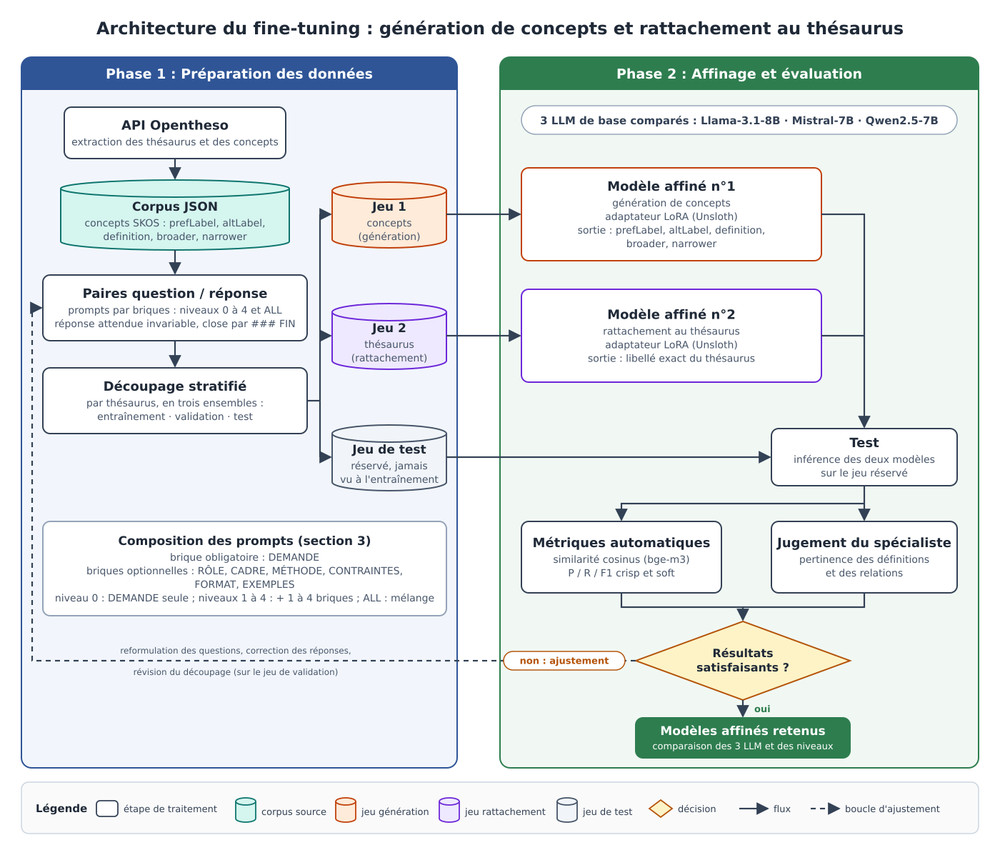

La chaîne se lit en deux phases. Dans la **phase de préparation**, le corpus JSON extrait d'Opentheso par son API est transformé en paires question / réponse, construites à partir des briques de prompt (section 3). Ces paires sont découpées de façon stratifiée par thésaurus en trois ensembles (entraînement, validation, test) et réparties en deux jeux, un par tâche. Dans la **phase d'affinage**, chaque jeu sert à entraîner son propre adaptateur LoRA (Unsloth) sur un même LLM de base. Trois LLM de base sont comparés dans les mêmes conditions : Llama-3.1-8B, Mistral-7B et Qwen2.5-7B. Les deux modèles affinés sont ensuite éprouvés sur le jeu de test réservé, et leurs résultats soumis à une double évaluation : métriques automatiques (similarité cosinus, précision, rappel et F1 crisp et soft) et jugement du spécialiste.

Les traits pointillés marquent la **boucle d'ajustement**. Lorsque les résultats ne sont pas satisfaisants, les enseignements tirés de l'évaluation, qu'ils viennent des métriques ou du jugement du spécialiste, reviennent alimenter la préparation des données : reformulation des questions, enrichissement ou correction des réponses de référence, révision du découpage. Le processus est donc itératif, et non linéaire : chaque cycle d'évaluation prépare l'entraînement suivant. Ces ajustements s'appuient sur le jeu de validation et jamais sur le jeu de test, sans quoi la mesure finale serait optimiste et la comparaison entre approches perdrait sa valeur.

## 3. Construction du jeu d'entraînement

Les données ont été transformées en paires **question / réponse**, format attendu pour l'affinage par instruction. Deux jeux distincts ont été constitués, un par modèle.

**Exemple 1 : question directe**

**a. Génération de concepts**

```
Question  : Donner le concept complet correspondant au terme « église ».

Réponse   : prefLabel  : ...
            altLabel   : ...
            definition : ...
            broader    : ...
            narrower   : ...
```

Chacun des concepts du corpus fournit un exemple : le `prefLabel` sert de terme d'entrée, les autres attributs constituent la réponse attendue.

**b. Rattachement au thésaurus**

```
Question  : À quel thésaurus appartient ce concept ?
            Terme : biotic factor
            Synonymes : environnement biotique
            Définition : Facteur écologique d'un milieu qui dépend des êtres
                         vivants et de leurs interactions positives ou négatives.
            Terme générique : environmental factor
            Termes spécifiques : bioturbation | activité microbienne |
                                 biological invasion | facteur zoogène
                                 
Réponse   : Thésaurus Biodiversité
```

Ici, la question présente une fiche de concept complète (terme, synonymes, définition, terme générique, termes spécifiques) et la réponse attendue est le titre du thésaurus de rattachement.

**Exemple 2 : patrons de prompt**

Dans l'exemple 1, chaque paire question / réponse est construite de manière directe : une seule formulation de question, une réponse, et le modèle est entraîné sur ces paires. Le problème est que le LLM ne généralise pas à toutes les formulations possibles d'une même demande : il apprend un déclencheur plutôt qu'une tâche.

Le corpus a donc été construit selon des **patrons de prompt** : chaque exemple est assemblé à partir d'une brique obligatoire (la DEMANDE) et d'un nombre variable de briques optionnelles. Le prompt final est un texte continu ; les briques ne sont qu'une grille de lecture de sa composition. Le modèle voit ainsi cinq niveaux de richesse de consigne, de la question nue (niveau 0) jusqu'au prompt le plus riche, avec rôle, exemple, cadre et méthode (niveau 4).

Un point structurant : **la réponse attendue est strictement identique dans tous les cas**, quelle que soit la question. C'est ce qui force le modèle à apprendre le format de sortie indépendamment de la formulation de l'entrée.

Pour le rattachement au thésaurus, le dispositif est le même que pour la génération de concepts : une brique obligatoire (la DEMANDE) et un nombre variable de briques optionnelles, assemblées en un texte continu. Cinq niveaux de richesse de consigne, quotas identiques, réponse strictement invariable.

La seule différence tient à l'entrée : la DEMANDE ne porte plus un terme isolé mais une fiche de concept complète avec tous ses attributs, notée `{concept}`.

### 3.1. Les briques disponibles

Le tableau suivant présente les briques utilisées pour construire les prompts.

| Brique | Fonction |
| --- | --- |
| **DEMANDE** | Brique obligatoire, présente dans tous les exemples. Formule la tâche. |
| **RÔLE** | Assigne une persona au modèle (documentaliste en terminologie du patrimoine). |
| **CADRE** | Situe la tâche dans son contexte métier (construction d'un thésaurus SKOS). |
| **MÉTHODE** | Décrit la procédure à suivre, champ par champ. |
| **CONTRAINTES** | Fixe les règles de validité (cardinalité, longueur, interdiction d'inventer). |
| **FORMAT** | Spécifie le gabarit de sortie attendu. |
| **EXEMPLES** | Fournit une démonstration complète (few-shot). |

L'objectif de ces briques est de construire un banc d'essai entre niveaux de consigne : cinq niveaux de prompt ont été définis, chacun ajoutant à la DEMANDE un nombre croissant de briques optionnelles, afin de comparer leur effet sur les résultats du modèle. Ils sont présentés ci-dessous, suivis du niveau ALL qui les mélange.

### 3.2. Les niveaux de prompt

#### 3.2.1. Niveau 0 : DEMANDE seule

**a. Génération de concepts**

```
Donner le concept complet correspondant au terme « {terme} ».
```

Composition :

- **DEMANDE** : Donner le concept complet correspondant au terme « {terme} ».

**b. Rattachement au thésaurus**

```
À quel thésaurus appartient ce concept ?
{concept}
```

Composition :

- **DEMANDE** : À quel thésaurus appartient ce concept ? {concept}

#### 3.2.2. Niveau 1 : DEMANDE et 1 brique

**a. Génération de concepts**

```
Tu es documentaliste spécialisé en terminologie du patrimoine culturel. 
Quel est le concept SKOS complet associé au terme « {terme} » ?
```

Composition :

- **RÔLE** : Tu es documentaliste spécialisé en terminologie du patrimoine culturel.
- **DEMANDE** : Quel est le concept SKOS complet associé au terme « {terme} » ?

**b. Rattachement au thésaurus**

```
Tu es documentaliste spécialisé en terminologie du patrimoine culturel.
Indique le thésaurus de rattachement du concept suivant.
{concept}
```

Composition :

- **RÔLE** : Tu es documentaliste spécialisé en terminologie du patrimoine culturel.
- **DEMANDE** : Indique le thésaurus de rattachement du concept suivant. {concept}

#### 3.2.3. Niveau 2 : DEMANDE et 2 briques

**a. Génération de concepts**

```
Dans le cadre de la construction d'un thésaurus SKOS pour une institution patrimoniale, produis le concept complet correspondant au terme « {terme} ». Complète le gabarit : prefLabel: ... / altLabel: ... / definition: ... / broader: ... / narrower: ...
```

Composition :

- **CADRE** : Dans le cadre de la construction d'un thésaurus SKOS pour une institution patrimoniale,
- **DEMANDE** : produis le concept complet correspondant au terme « {terme} ».
- **FORMAT** : Complète le gabarit : prefLabel: ... / altLabel: ... / definition: ... / broader: ... / narrower: ...

**b. Rattachement au thésaurus**

```
Dans le cadre de l'indexation d'une notice dans la base Opentheso, détermine le thésaurus auquel rattacher le concept suivant. {concept} Réponds uniquement par le libellé du thésaurus, sur une seule ligne.
```

Composition :

- **CADRE** : Dans le cadre de l'indexation d'une notice dans la base Opentheso,
- **DEMANDE** : détermine le thésaurus auquel rattacher le concept suivant. {concept}
- **FORMAT** : Réponds uniquement par le libellé du thésaurus, sur une seule ligne.

#### 3.2.4. Niveau 3 : DEMANDE et 3 briques

**a. Génération de concepts**

```
Concept complet : « {terme} ». Procède champ par champ : d'abord la forme retenue, puis les synonymes, puis la définition, puis le générique, puis les spécifiques. Contraintes : un seul broader, définition d'une à deux phrases, aucun terme inventé, champ vide noté (aucun). Renvoie les cinq champs dans l'ordre prefLabel, altLabel, definition, broader, narrower, un champ par ligne, valeurs multiples séparées par un point-virgule.
```

Composition :

- **DEMANDE** : Concept complet : « {terme} ».
- **MÉTHODE** : Procède champ par champ : d'abord la forme retenue, puis les synonymes, puis la définition, puis le générique, puis les spécifiques.
- **CONTRAINTES** : un seul broader, définition d'une à deux phrases, aucun terme inventé, champ vide noté (aucun).
- **FORMAT** : Renvoie les cinq champs dans l'ordre prefLabel, altLabel, definition, broader, narrower, un champ par ligne, valeurs multiples séparées par un point-virgule.

**b. Rattachement au thésaurus**

```
Thésaurus de rattachement ? {concept} Procède ainsi : identifie d'abord le domaine du concept à partir de sa définition et de ses relations, puis retiens le thésaurus dont le périmètre couvre ce domaine. Contraintes : un seul thésaurus, libellé exact tel qu'il figure dans la base, aucun thésaurus inventé, aucune justification. Renvoie le libellé seul, sur une ligne, sans phrase ni ponctuation finale.
```

Composition :

- **DEMANDE** : Thésaurus de rattachement ? {concept}
- **MÉTHODE** : Procède ainsi : identifie d'abord le domaine du concept à partir de sa définition et de ses relations, puis retiens le thésaurus dont le périmètre couvre ce domaine.
- **CONTRAINTES** : un seul thésaurus, libellé exact tel qu'il figure dans la base, aucun thésaurus inventé, aucune justification.
- **FORMAT** : Renvoie le libellé seul, sur une ligne, sans phrase ni ponctuation finale.

#### 3.2.5. Niveau 4 : DEMANDE et 4 briques

**a. Génération de concepts**

```
Tu es documentaliste spécialisé en terminologie du patrimoine culturel. Exemple. Terme : « {terme exemple} » → prefLabel: ... / altLabel: ... / definition: ... / broader: ... / narrower: ... / ### FIN. Dans le cadre de la construction d'un thésaurus SKOS pour une institution patrimoniale, quel est le concept SKOS complet associé au terme « {terme} » ? Procède champ par champ : d'abord la forme retenue, puis les synonymes, puis la définition, puis le générique, puis les spécifiques.
```

Composition :

- **RÔLE** : Tu es documentaliste spécialisé en terminologie du patrimoine culturel.
- **EXEMPLES** : Exemple. Terme : « {terme exemple} » → prefLabel: ... / altLabel: ... / definition: ... / broader: ... / narrower: ... / ### FIN
- **CADRE** : Dans le cadre de la construction d'un thésaurus SKOS pour une institution patrimoniale,
- **DEMANDE** : quel est le concept SKOS complet associé au terme « {terme} » ?
- **MÉTHODE** : Procède champ par champ : d'abord la forme retenue, puis les synonymes, puis la définition, puis le générique, puis les spécifiques.

**b. Rattachement au thésaurus**

```
Tu es documentaliste spécialisé en terminologie du patrimoine culturel. Exemple. Terme : « {terme exemple} » / Définition : ... / Terme générique : ... → Architecture religieuse / ### FIN. Dans le cadre de l'indexation d'une notice dans la base Opentheso, à quel thésaurus appartient le concept suivant ? {concept} Procède ainsi : identifie d'abord le domaine du concept à partir de sa définition et de ses relations, puis retiens le thésaurus dont le périmètre couvre ce domaine.
```

Composition :

- **RÔLE** : Tu es documentaliste spécialisé en terminologie du patrimoine culturel.
- **EXEMPLES** : Exemple. Terme : « {terme exemple} » / Définition : ... / Terme générique : ... → Architecture religieuse / ### FIN
- **CADRE** : Dans le cadre de l'indexation d'une notice dans la base Opentheso,
- **DEMANDE** : à quel thésaurus appartient le concept suivant ? {concept}
- **MÉTHODE** : Procède ainsi : identifie d'abord le domaine du concept à partir de sa définition et de ses relations, puis retiens le thésaurus dont le périmètre couvre ce domaine.

#### 3.2.6. Niveau ALL : mélange des niveaux 0 à 4

Le niveau ALL mélange tous les formats précédents : les exemples des niveaux 0 à 4 sont réunis dans un même corpus. Chaque concept n'y apparaît qu'une seule fois, formulé selon un seul niveau de prompt, et chaque niveau est représenté dans une proportion fixée : 20 % pour le niveau 0, 25 % pour les niveaux 1 et 2, 20 % pour le niveau 3 et 10 % pour le niveau 4. Ces proportions sont les mêmes dans les ensembles d'entraînement, de validation et de test. Le modèle rencontre ainsi, pendant l'entraînement, des consignes allant de la question nue au prompt le plus riche, ce qui doit le rendre robuste à la manière dont l'utilisateur formule sa demande. Ce niveau sert aussi de point de comparaison avec les modèles entraînés sur un seul niveau. Les deux tableaux suivants détaillent la répartition des exemples par niveau, pour chaque tâche.

**a. Génération de concepts**

Le niveau ALL de la génération de concepts reprend le découpage des niveaux 0 à 3, soit 2 405 concepts complets : 1 684 en entraînement, 361 en validation et 360 en test. Les niveaux 1 et 2, de complexité intermédiaire, sont les plus représentés (25 % chacun), tandis que le niveau 4, dont les prompts sont les plus longs, ne compte que pour 10 % (168 exemples d'entraînement).

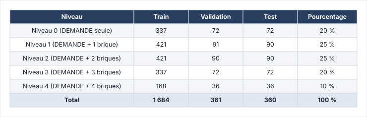

**b. Rattachement au thésaurus**

Pour le rattachement au thésaurus, le niveau ALL porte sur l'ensemble des 39 214 concepts : 27 783 en entraînement, 5 700 en validation et 5 731 en test. La répartition entre niveaux est la même que pour la génération de concepts (20 %, 25 %, 25 %, 20 % et 10 %), ce qui rend les deux tâches comparables. Les volumes sont en revanche environ seize fois plus importants, puisque cette tâche n'est pas limitée aux concepts complets.


### 3.3. Réponse attendue

**a. Génération de concepts**

Format strictement identique dans tous les exemples, quelle que soit la question posée.

```
prefLabel: ...
altLabel: ... ; ...
definition: ...
broader: ...
narrower: ... ; ... ; ...
### FIN
```

Les cinq champs apparaissent toujours dans le même ordre, un par ligne. Les valeurs multiples sont séparées par un point-virgule. Le marqueur `### FIN` sert de sentinelle de fin de génération.

**b. Rattachement au thésaurus**

Format strictement identique dans tous les exemples, quelle que soit la question posée.

```
{titre du thésaurus}
### FIN
```

Le libellé du thésaurus est repris **exactement** tel qu'il figure dans la base, sans préfixe ajouté : la résolution vers l'identifiant se fait par correspondance exacte, et un préfixe constant ne distinguerait aucun cas tout en obligeant à nettoyer chaque sortie. Le marqueur `### FIN` sert de sentinelle de fin de génération, comme pour la génération de concepts.

### 3.4. Jeu de données

**3.4.1. Origine**

Les données ont été extraites au moyen de l'**API d'Opentheso**, depuis un serveur de test. Elles proviennent du référentiel Loterre et constituent un ensemble de thésaurus déjà structurés et validés : c'est donc une source de référence fiable, pour l'apprentissage comme pour l'évaluation.

**3.4.2. Structure**

Le corpus se présente sous la forme d'un répertoire de fichiers JSON, un fichier par thésaurus. Chaque fichier comporte deux parties.

L'en-tête du thésaurus décrit le vocabulaire lui-même :

| Attribut | Description |
| --- | --- |
| `idTheso` | Identifiant du thésaurus |
| `type` | Type de vocabulaire |
| `titres` | Titre, décliné par langue |
| `langues` | Langues disponibles |
| `nb_concepts` | Nombre de concepts contenus |

La liste des concepts, chacun décrit par :

| Attribut | Description |
| --- | --- |
| `id` | Identifiant du concept |
| `uri` | Identifiant pérenne, sous forme d'ARK |
| `prefLabel` | Libellé préférentiel |
| `altLabel` | Libellés alternatifs et synonymes |
| `definition` | Définition, accompagnée de sa source |
| `broader` | Concepts plus génériques |
| `narrower` | Concepts plus spécifiques |
| `isTopConcept` | Indique si le concept est à la racine de la hiérarchie |

Cette structure correspond directement au vocabulaire SKOS, ce qui garantit la cohérence entre les données d'apprentissage et le format de sortie attendu.

**3.4.3. Volumétrie**

Le tableau suivant présente les statistiques des données récupérées par l'API d'Opentheso. Ces données sont dynamiques : de nouveaux concepts et thésaurus sont régulièrement ajoutés dans Opentheso, si bien que ces chiffres peuvent varier d'une extraction à l'autre. Un même concept pouvant appartenir à plusieurs thésaurus (1,41 en moyenne), le nombre moyen de concepts par thésaurus (202) est supérieur au simple rapport entre le nombre de concepts et le nombre de thésaurus.

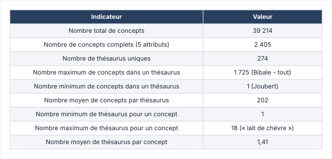

Les deux tâches n'utilisent pas les mêmes données. Pour la **génération de concepts**, seuls les concepts complets ont été retenus, c'est-à-dire ceux dont les cinq attributs (`prefLabel`, `altLabel`, `definition`, `broader`, `narrower`) sont renseignés. Le modèle doit en effet apprendre qu'une sortie est toujours complète : entraîné sur des concepts partiels, il apprendrait aussi à laisser des attributs vides. Pour le **rattachement au thésaurus**, la contrainte est différente : le modèle ne produit que le titre du thésaurus, renseigné pour tous les concepts. L'ensemble des concepts récupérés peut donc être utilisé, même incomplets.

**3.4.4. Découpage**

Les données sont divisées en trois ensembles : 70 % pour l'entraînement, 15 % pour la validation (réglage des paramètres et arrêt de l'entraînement) et 15 % pour le test, qui sert à l'évaluation finale.

Pour la génération de concepts, ce découpage s'applique aux niveaux 0 à 3 et au niveau ALL, sur un total de 2 405 concepts complets. Le niveau 4 demande un traitement particulier, car ses prompts contiennent un exemple complet (brique EXEMPLES). Une partie des concepts est donc mise en réserve pour servir uniquement d'exemples, afin que les exemples insérés dans les prompts restent distincts des concepts d'entraînement, de validation et de test. Le découpage devient alors 70 % pour l'entraînement, 10 % pour la validation, 10 % pour le test et 10 % pour la réserve d'exemples, sur un total de 2 698 concepts complets. Ce total diffère du précédent parce que les données ont été extraites à nouveau après les expériences sur les autres niveaux, et que la base Opentheso avait évolué entre-temps.

Le niveau ALL n'a pas fait l'objet de cette réserve : il ne contient que 10 % d'exemples de niveau 4, si bien que l'effet attendu sur les résultats est négligeable.

Pour le rattachement au thésaurus, toutes les données ont été utilisées, puisque le titre du thésaurus est renseigné même lorsque le concept est incomplet. Le découpage est de 70,8 % pour l'entraînement, 14,5 % pour la validation et 14,6 % pour le test, sur un total de 39 214 concepts. Le tableau suivant récapitule les trois découpages.

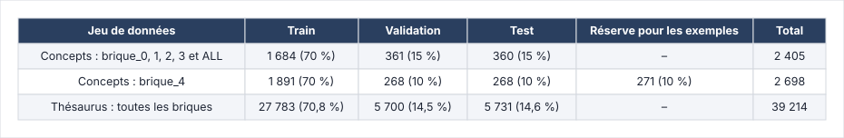

## 4. Modèles évalués et chaîne d'outils

### 4.1. Modèles évalués

Parmi les nombreux LLM disponibles, trois ont été retenus, choisis parmi les plus utilisés dans les projets fondés sur les LLM : Llama 3.1 (Meta), Mistral (Mistral AI) et Qwen 2.5 (Alibaba Cloud). Mistral, développé en France, a notamment été choisi pour sa bonne compréhension du français. Llama et Qwen sont deux familles de référence, reconnues pour leurs performances. Les trois modèles sont de taille comparable (7 à 8 milliards de paramètres) et sont utilisés dans leur version Instruct, déjà entraînée à suivre des consignes.

Un second critère a guidé ce choix : ces trois familles sont **open source** et peuvent être exécutées localement. Les modèles propriétaires, comme Claude ou GPT, ne sont accessibles que par une API externe, ce qui obligerait à transmettre les données à un service tiers. Les modèles sont téléchargés depuis **Hugging Face**, la plateforme qui héberge les modèles d'IA, puis exécutés en local sur le serveur, notamment avec **Ollama**, un outil qui fait tourner des modèles d'IA en local. Le tableau suivant présente les trois modèles.

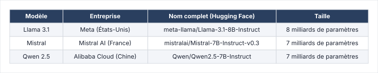

### 4.2. Outils et technologies

Le tableau suivant présente les outils et technologies utilisés pour le fine-tuning des deux modèles (génération de concepts et rattachement au thésaurus). Ils sont rangés dans l'ordre des étapes du projet :

- préparation des données, extraites de l'API Opentheso puis transformées en paires question / réponse ;
- entraînement, avec la méthode LoRA sur trois modèles de base téléchargés depuis Hugging Face ;
- inférence, pour générer les prédictions sur le jeu de test, avec le modèle quantifié en 4 bits pour réduire la mémoire GPU ;
- évaluation, qui compare ces prédictions aux réponses de référence.

L'ensemble tourne sur un serveur Linux équipé de deux GPU NVIDIA H100 NVL (94 Go de mémoire chacun).

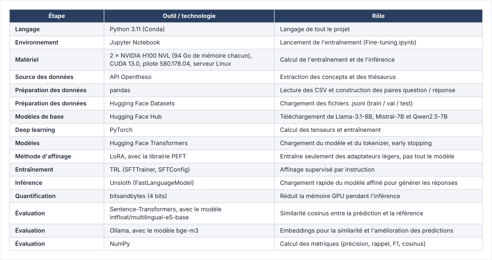

## 5. Méthodes d'évaluation

Les résultats produits par les deux modèles font l'objet de deux évaluations complémentaires.

**Les métriques d'évaluation** mesurent automatiquement l'écart entre la sortie du modèle et la référence issue d'Opentheso, sur la portion du corpus réservée au test. Elles fournissent une mesure reproductible, applicable à l'ensemble des exemples.

**La validation humaine** repose sur l'examen des résultats par un spécialiste. Elle porte sur ce que les métriques ne captent pas : la pertinence documentaire d'une définition, la justesse d'une relation hiérarchique, l'acceptabilité d'un synonyme.

Les deux sont nécessaires. Une métrique élevée peut masquer des propositions inutilisables, et un jugement humain seul ne se généralise pas à plusieurs milliers de concepts.

### 5.1. Métriques d'évaluation : génération de concepts

#### 5.1.1. Métriques d'entraînement

Le tableau suivant présente les métriques suivies pendant l'entraînement. Elles permettent de contrôler la qualité de l'apprentissage, en particulier à travers l'évolution de la perte (loss) sur les ensembles d'entraînement et de validation : si la perte de validation remonte alors que la perte d'entraînement continue de baisser, le modèle commence à surapprendre.

| Métrique | Ce qu'elle mesure |
| --- | --- |
| **Époque** | Un passage complet sur toutes les données d'entraînement |
| **Training Loss** | L'erreur sur les données que le modèle est en train d'apprendre |
| **Validation Loss** | La même erreur, mesurée sur le jeu de validation, que le modèle ne voit pas pendant l'entraînement |
| **Entropy** | Le niveau d'hésitation du modèle dans ses prédictions |
| **Num Tokens** | Nombre cumulé de tokens (morceaux de texte) traités |
| **Mean Token Accuracy** | Part des tokens correctement prédits |

#### 5.1.2. Similarité cosinus

La similarité cosinus mesure à quel point deux textes ont le même sens. Chaque texte est d'abord transformé en vecteur (une liste de nombres) par un modèle d'embeddings, multilingual-e5-base ou bge-m3. On mesure ensuite l'angle entre les deux vecteurs : plus l'angle est petit, plus les textes sont proches.

Formule :

$$
\text{cos}(A, B) = \frac{A \cdot B}{|A| \times |B|}
$$

- $A \cdot B$ : le produit scalaire des deux vecteurs, c'est-à-dire la somme des produits terme à terme ;
- $|A|$ et $|B|$ : la longueur (norme) de chaque vecteur.

Lecture du score :

- 1 : même sens ;
- 0 : aucun rapport ;
- en pratique, avec ces modèles, le score se situe entre 0 et 1.

Exemple : « église » et « édifice religieux » donnent un score élevé, autour de 0,85. « église » et « poterie » donnent un score faible.

Pour la génération de concepts, la similarité cosinus est calculée séparément pour chaque attribut produit par le modèle : `altLabel`, `definition`, `broader` et `narrower`. C'est la seule mesure qui s'applique à la `definition`, puisqu'il s'agit d'un texte libre et non d'une liste de termes.

Plusieurs mesures de similarité existent. La similarité cosinus a été retenue pour deux raisons :

- Elle compare le sens, pas les mots exacts.
Un modèle peut donner une bonne réponse avec d'autres mots : « édifice religieux » au lieu de « église ». Les métriques qui comparent les mots, comme la correspondance exacte, BLEU ou ROUGE, compteraient cette réponse comme fausse. La similarité cosinus la reconnaît comme proche.
- Elle ne dépend pas de la longueur du texte.
Elle mesure l'angle entre les vecteurs, pas leur taille. Une définition courte et une définition longue qui disent la même chose obtiennent un bon score. Avec la distance euclidienne, l'autre façon de comparer deux vecteurs, une différence de longueur pénalise le score.

Le tableau suivant compare la similarité cosinus aux autres mesures possibles, et précise la limite de chacune pour ce projet :

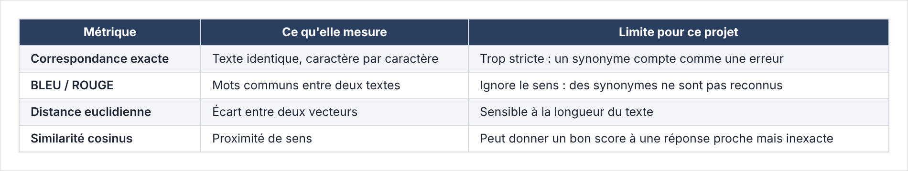

La similarité cosinus a elle aussi une limite : elle peut donner un bon score à une réponse proche mais inexacte. Elle est donc complétée par la précision, le rappel et le F1-score.

#### 5.1.3. Précision, rappel et F1 : versions crisp et soft

Deux variantes de la précision, du rappel et du F1-score sont utilisées : la version **crisp**, fondée sur la correspondance exacte, et la version **soft**, qui tient compte du sens.

Ces trois mesures servent à évaluer des **listes de termes** : on compare la liste prédite par le modèle à la liste de référence, terme par terme. Pour la génération de concepts, elles s'appliquent donc uniquement aux attributs qui prennent la forme d'une liste :

- `altLabel` : la liste des synonymes ;
- `broader` : le ou les termes génériques ;
- `narrower` : la liste des termes spécifiques.

La `definition` n'est pas concernée : c'est un texte continu, et non une liste de termes, qu'on ne peut pas découper en éléments à compter. Elle est évaluée uniquement par la similarité cosinus (section 5.1.2).

**Précision** : parmi les termes donnés par le modèle, combien sont corrects ? Elle mesure si le modèle évite d'inventer des termes.

$$
\text{Précision} = \frac{\text{termes corrects prédits}}{\text{total des termes prédits}}
$$

**Rappel** : parmi les termes attendus, combien le modèle a-t-il retrouvés ? Il mesure si le modèle n'oublie pas de termes.

$$
\text{Rappel} = \frac{\text{termes corrects prédits}}{\text{total des termes attendus}}
$$

**F1-score** : la moyenne harmonique de la précision et du rappel. Il résume les deux en un seul score, et il est élevé seulement si les deux sont bons.

$$
F1 = 2 \times \frac{\text{Précision} \times \text{Rappel}}{\text{Précision} + \text{Rappel}}
$$

Exemple :

- Référence (narrower de « Garnet ») : Almandin, Grossular, Pyrop, Spessartin
- Prédiction du modèle : Almandin, Pyrop, Quartz

| Mesure | Calcul | Score |
| --- | --- | --- |
| Précision | 2 corrects / 3 prédits | 0,67 |
| Rappel | 2 corrects / 4 attendus | 0,50 |
| F1-score | 2 × (0,67 × 0,50) / (0,67 + 0,50) | 0,57 |

Seuls Almandin et Pyrop sont retrouvés : Quartz est une erreur (il fait baisser la précision), et Grossular et Spessartin sont oubliés (ils font baisser le rappel).

Ce calcul est dit **crisp** : c'est la méthode traditionnelle, qui compare les termes mot à mot, sous leur forme exacte, sans tenir compte du sens. Or un LLM peut produire un terme correct mais formulé autrement que dans la référence, et la méthode crisp le compte alors comme une erreur. C'est pourquoi la méthode **soft** a également été utilisée. Elle est présentée dans l'article de **Fränti, P., Mariescu-Istodor, R. (2023). « Soft precision and recall ». *Pattern Recognition Letters*, 167, p. 115-121. doi:10.1016/j.patrec.2023.02.005** (accès ouvert, licence CC BY). Le détail de la méthode et sa comparaison avec la méthode crisp sont présentés dans la page [Soft Precision and Recall : méthodologie détaillée](Soft%20Precision%20and%20Recall%20m%C3%A9thodologie%20d%C3%A9taill%C3%A9e%203dfd3be13e5880a0ab06e1404f0d241a.md).

### 5.2. Métriques d'évaluation : rattachement au thésaurus

**Les métriques d'entraînement** sont les mêmes que celles de la section 5.1.1 (Training Loss, Validation Loss, Entropy, Num Tokens, Mean Token Accuracy). Elles servent ici aussi à suivre l'apprentissage et à détecter le surapprentissage.

**La similarité cosinus** est calculée entre le titre de thésaurus prédit par le modèle et le titre attendu dans le jeu de test, selon la même méthode qu'à la section 5.1.2. Un score proche de 1 indique que le modèle a donné le bon titre, ou un titre de sens très voisin. Le score est ensuite moyenné sur l'ensemble des exemples de test.

**La précision, le rappel et le F1 (crisp et soft) ne sont pas utilisés** pour cette tâche. Ces mesures comparent deux listes de termes, comme les `altLabel`, `broader` et `narrower` d'un concept. Or la sortie du modèle est ici un seul titre de thésaurus, composé d'un ou de quelques mots : il n'y a pas de liste à comparer, donc pas de termes à compter.

### 5.3. Validation humaine : boucle avec le spécialiste (human-in-the-loop)

Les métriques automatiques donnent une mesure globale, mais elles ne disent pas si une proposition est réellement utilisable par un documentaliste. La validation humaine complète donc l'évaluation : un spécialiste examine les sorties du modèle et décide si elles peuvent être acceptées. Ce n'est pas un simple contrôle final, mais une **boucle** : tant que le résultat n'est pas validé, il est retravaillé puis soumis à nouveau.

Le déroulement est le suivant :

1. **Génération.** Le modèle affiné reçoit un prompt et produit une proposition : un concept complet (`altLabel`, `definition`, `broader`, `narrower`) ou un titre de thésaurus.
2. **Examen par le spécialiste.** Le spécialiste juge la proposition sur ce que les métriques ne captent pas : pertinence documentaire de la définition, justesse des relations hiérarchiques, acceptabilité des synonymes, choix du bon thésaurus.
3. **Décision.** Trois cas sont possibles : la proposition est **acceptée** telle quelle, **acceptée après une correction mineure** faite directement par le spécialiste, ou **rejetée**.
4. **Modification du prompt.** En cas de rejet, le spécialiste peut modifier le prompt plutôt que le résultat : reformuler la demande, ou ajouter des briques (RÔLE, CADRE, CONTRAINTES, EXEMPLES) pour mieux guider le modèle.
5. **Nouvelle génération.** Le modèle est relancé avec le prompt modifié, et la nouvelle proposition revient à l'étape 2. La boucle s'arrête quand la proposition est validée.

Cette boucle a deux intérêts. D'une part, aucune proposition n'entre dans le thésaurus sans l'accord d'un spécialiste : le modèle assiste le documentaliste, il ne le remplace pas. D'autre part, les retours du spécialiste servent à améliorer le système : les propositions validées et les prompts qui ont fonctionné peuvent enrichir le corpus de paires question / réponse lors d'un prochain cycle d'entraînement. C'est la boucle d'ajustement présentée dans l'architecture (section 2).

## 6. Résultats du fine-tuning et évaluation

Cette section présente les résultats obtenus sur le jeu de test pour les deux tâches. Ils sont donnés niveau de prompt par niveau de prompt (niveaux 0 à 4, puis niveau ALL), pour les trois LLM de base : Llama 3.1, Mistral et Qwen 2.5. Les métriques utilisées sont celles décrites à la section 5.

### 6.1. Génération de concepts

Pour chaque niveau, les résultats sont présentés dans le même ordre : métriques d'entraînement, similarité cosinus par attribut, puis précision, rappel et F1 en versions crisp et soft (pour `altLabel`, `broader` et `narrower`).

#### 6.1.1. Niveau 0 : DEMANDE seule

**a. Métriques d'entraînement**

Le tableau ci-dessous donne, pour chaque modèle et à chaque époque, la training loss, la validation loss, l'entropie, le nombre cumulé de tokens vus et la token accuracy moyenne. La cellule surlignée marque la validation loss minimale de chaque modèle : époque 2 pour les trois modèles. La plus basse est celle de Llama-3.1-8B (0,790170).

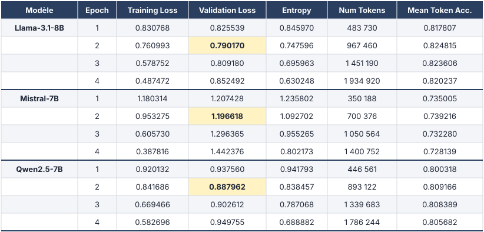

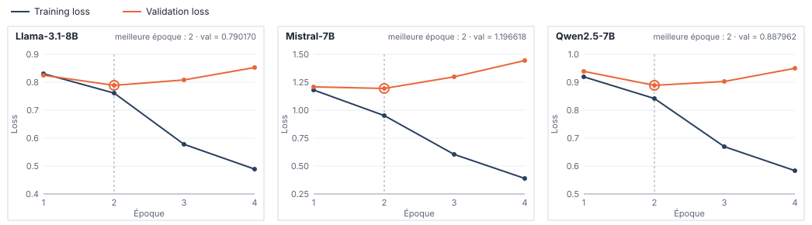

La figure ci-dessus présente un panneau par modèle : la training loss (pointillé) et la validation loss (trait plein) en fonction de l'époque, le cercle marquant la meilleure époque. La training loss baisse jusqu'à la dernière époque, alors que la validation loss remonte après la meilleure époque : au-delà, le modèle commence à surapprendre, et c'est donc le checkpoint de la meilleure époque qui est retenu.

**b. Similarité cosinus**

Le tableau ci-dessous donne la similarité cosinus moyenne entre la valeur prédite et la valeur de référence, pour chaque attribut, puis la moyenne des quatre attributs (dernière ligne). La meilleure valeur de chaque ligne est surlignée. En moyenne, Mistral-7B obtient le meilleur score (0,593).

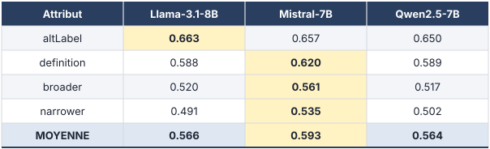

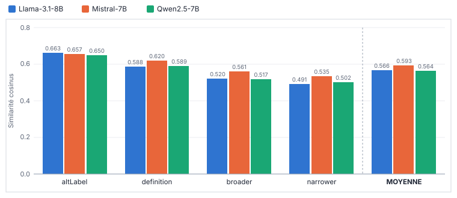

Le graphique ci-dessus reprend ces valeurs par attribut. L'attribut le mieux reproduit est `altLabel` (de 0,650 à 0,663 selon le modèle), le moins bien reproduit est `narrower` (de 0,491 à 0,535). Sur la moyenne, l'écart entre le meilleur et le moins bon modèle est de 0,029.

**c. Précision, rappel et F1 : version crisp**

Le tableau ci-dessous donne la précision (P), le rappel (R) et le F1 calculés en correspondance exacte, pour `altLabel`, `broader` et `narrower`. Dans chaque champ, le meilleur score de chaque colonne est surligné. Les scores restent bas : le F1 le plus élevé est 0,078 (`broader`, Mistral-7B). Pour `broader`, P, R et F1 sont identiques : le nombre de termes prédits est égal au nombre de termes attendus.

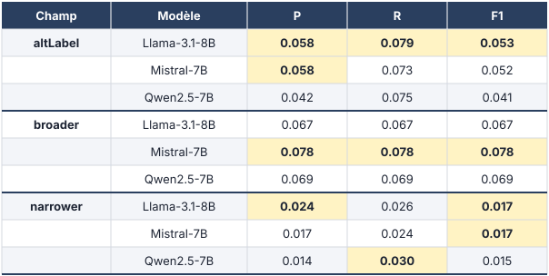

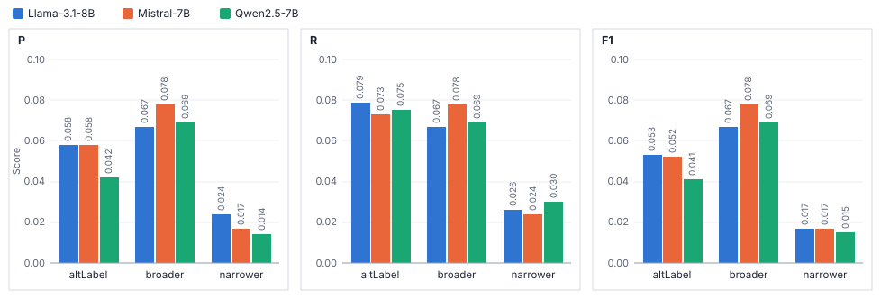

Le graphique ci-dessus présente un panneau par mesure (P, R, F1), avec les trois champs et les trois modèles. Meilleur F1 : Llama-3.1-8B pour `altLabel` (0,053), Mistral-7B pour `broader` (0,078) et Llama-3.1-8B et Mistral-7B pour `narrower` (0,017). Ces valeurs basses viennent surtout de la comparaison mot à mot : un terme juste mais formulé autrement que dans la référence est compté comme faux.

**d. Précision, rappel et F1 : version soft**

Le tableau ci-dessous donne la précision, le rappel et le F1 en version soft (Fränti et Mariescu-Istodor, 2023), qui accepte un terme proche par le sens. Dans chaque champ, le meilleur score de chaque colonne est surligné. Les scores sont nettement plus élevés qu'en version crisp : pour `altLabel`, le F1 va de 0,041 à 0,053 en crisp, contre 0,5734 à 0,6473 en soft, selon le modèle.

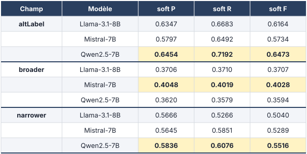

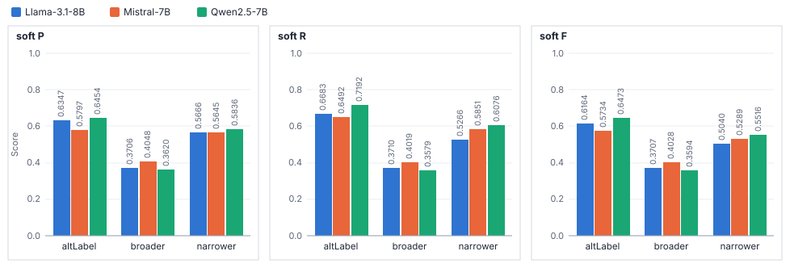

Le graphique ci-dessus présente un panneau par mesure (soft P, soft R, soft F), avec les trois champs et les trois modèles. Meilleur soft F : Qwen2.5-7B pour `altLabel` (0,6473), Mistral-7B pour `broader` (0,4028) et Qwen2.5-7B pour `narrower` (0,5516). L'écart avec la version crisp montre que beaucoup de termes prédits sont proches par le sens de la référence, sans en reprendre la forme exacte.

#### 6.1.2. Niveau 1 : DEMANDE et 1 brique

**a. Métriques d'entraînement**

Le tableau ci-dessous donne, pour chaque modèle et à chaque époque, la training loss, la validation loss, l'entropie, le nombre cumulé de tokens vus et la token accuracy moyenne. La cellule surlignée marque la validation loss minimale de chaque modèle : époque 2 pour les trois modèles. La plus basse est celle de Llama-3.1-8B (0,735997).

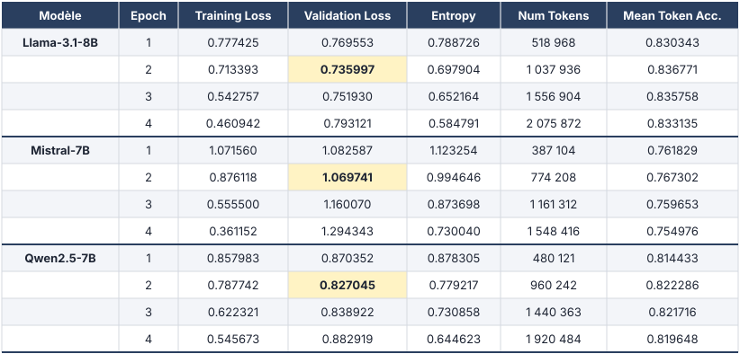

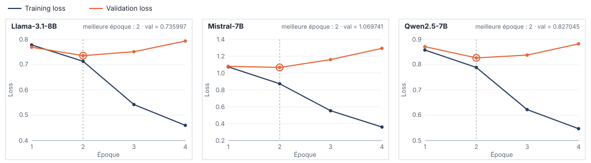

La figure ci-dessus présente un panneau par modèle : la training loss (pointillé) et la validation loss (trait plein) en fonction de l'époque, le cercle marquant la meilleure époque. La training loss baisse jusqu'à la dernière époque, alors que la validation loss remonte après la meilleure époque : au-delà, le modèle commence à surapprendre, et c'est donc le checkpoint de la meilleure époque qui est retenu.

**b. Similarité cosinus**

Le tableau ci-dessous donne la similarité cosinus moyenne entre la valeur prédite et la valeur de référence, pour chaque attribut, puis la moyenne des quatre attributs (dernière ligne). La meilleure valeur de chaque ligne est surlignée. En moyenne, Llama-3.1-8B et Qwen2.5-7B obtiennent le meilleur score (0,567).

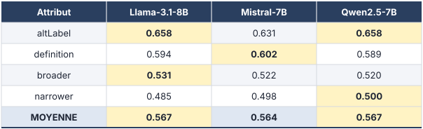

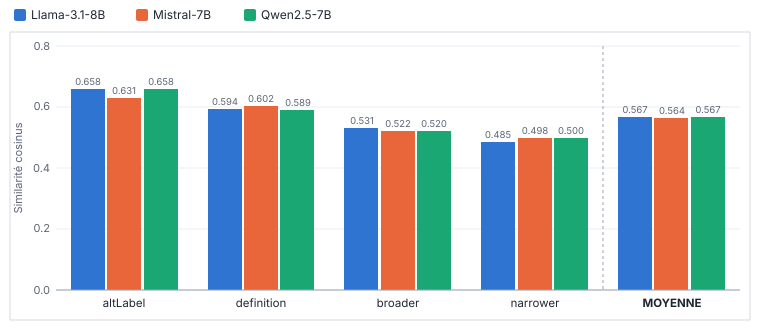

Le graphique ci-dessus reprend ces valeurs par attribut. L'attribut le mieux reproduit est `altLabel` (de 0,631 à 0,658 selon le modèle), le moins bien reproduit est `narrower` (de 0,485 à 0,500). Sur la moyenne, l'écart entre le meilleur et le moins bon modèle est de 0,003.

**c. Précision, rappel et F1 : version crisp**

Le tableau ci-dessous donne la précision (P), le rappel (R) et le F1 calculés en correspondance exacte, pour `altLabel`, `broader` et `narrower`. Dans chaque champ, le meilleur score de chaque colonne est surligné. Les scores restent bas : le F1 le plus élevé est 0,086 (`broader`, Llama-3.1-8B). Pour `broader`, P, R et F1 sont identiques : le nombre de termes prédits est égal au nombre de termes attendus.

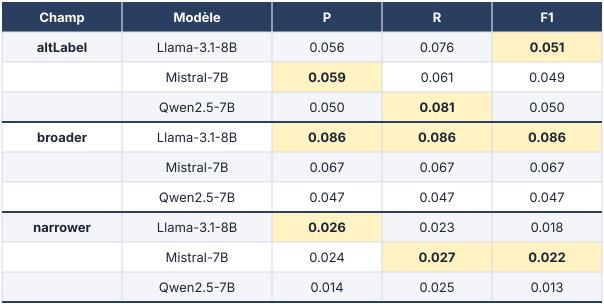

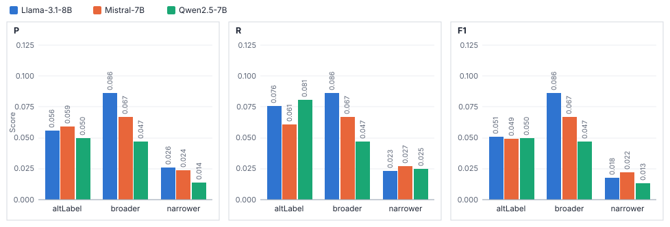

Le graphique ci-dessus présente un panneau par mesure (P, R, F1), avec les trois champs et les trois modèles. Meilleur F1 : Llama-3.1-8B pour `altLabel` (0,051), Llama-3.1-8B pour `broader` (0,086) et Mistral-7B pour `narrower` (0,022). Ces valeurs basses viennent surtout de la comparaison mot à mot : un terme juste mais formulé autrement que dans la référence est compté comme faux.

**d. Précision, rappel et F1 : version soft**

Le tableau ci-dessous donne la précision, le rappel et le F1 en version soft (Fränti et Mariescu-Istodor, 2023), qui accepte un terme proche par le sens. Dans chaque champ, le meilleur score de chaque colonne est surligné. Les scores sont nettement plus élevés qu'en version crisp : pour `altLabel`, le F1 va de 0,049 à 0,051 en crisp, contre 0,5544 à 0,6375 en soft, selon le modèle.

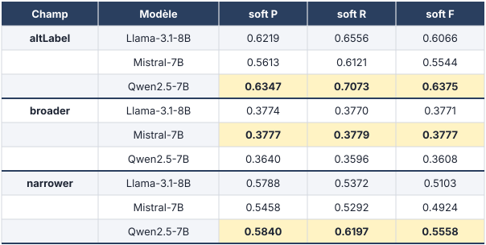

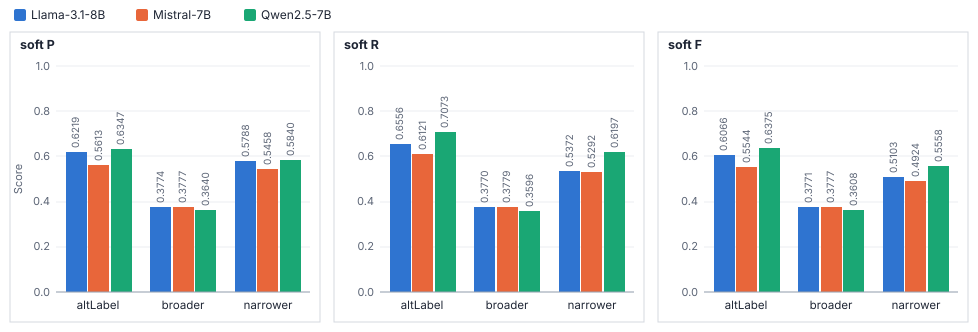

Le graphique ci-dessus présente un panneau par mesure (soft P, soft R, soft F), avec les trois champs et les trois modèles. Meilleur soft F : Qwen2.5-7B pour `altLabel` (0,6375), Mistral-7B pour `broader` (0,3777) et Qwen2.5-7B pour `narrower` (0,5558). L'écart avec la version crisp montre que beaucoup de termes prédits sont proches par le sens de la référence, sans en reprendre la forme exacte.

#### 6.1.3. Niveau 2 : DEMANDE et 2 briques

**a. Métriques d'entraînement**

Le tableau ci-dessous donne, pour chaque modèle et à chaque époque, la training loss, la validation loss, l'entropie, le nombre cumulé de tokens vus et la token accuracy moyenne. La cellule surlignée marque la validation loss minimale de chaque modèle : époque 2 pour les trois modèles. La plus basse est celle de Llama-3.1-8B (0,677459).

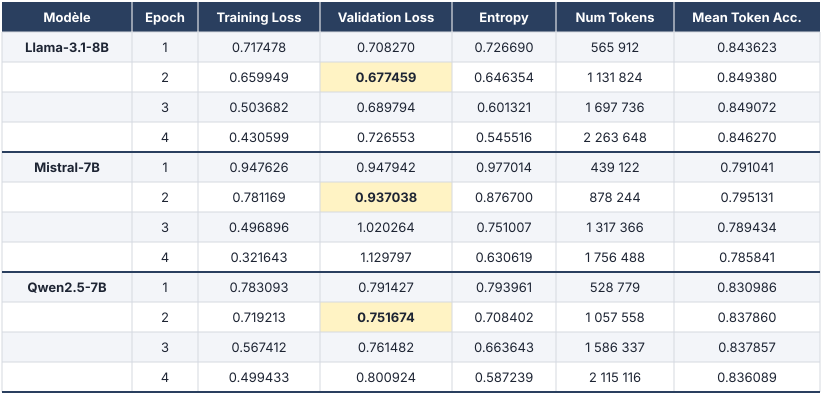

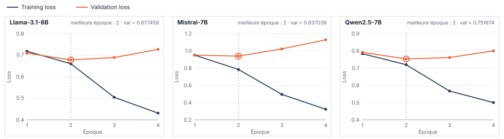

La figure ci-dessus présente un panneau par modèle : la training loss (pointillé) et la validation loss (trait plein) en fonction de l'époque, le cercle marquant la meilleure époque. La training loss baisse jusqu'à la dernière époque, alors que la validation loss remonte après la meilleure époque : au-delà, le modèle commence à surapprendre, et c'est donc le checkpoint de la meilleure époque qui est retenu.

**b. Similarité cosinus**

Le tableau ci-dessous donne la similarité cosinus moyenne entre la valeur prédite et la valeur de référence, pour chaque attribut, puis la moyenne des quatre attributs (dernière ligne). La meilleure valeur de chaque ligne est surlignée. En moyenne, Qwen2.5-7B obtient le meilleur score (0,576).

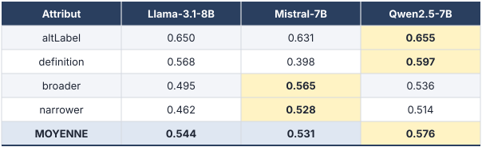

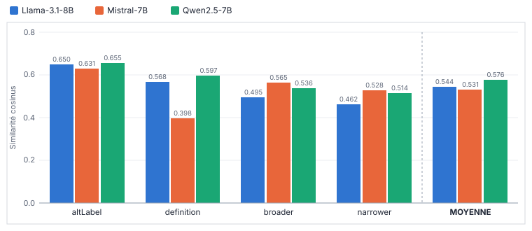

Le graphique ci-dessus reprend ces valeurs par attribut. L'attribut le mieux reproduit est `altLabel` (de 0,631 à 0,655 selon le modèle), le moins bien reproduit est `narrower` (de 0,462 à 0,528). Sur la moyenne, l'écart entre le meilleur et le moins bon modèle est de 0,045.

**c. Précision, rappel et F1 : version crisp**

Le tableau ci-dessous donne la précision (P), le rappel (R) et le F1 calculés en correspondance exacte, pour `altLabel`, `broader` et `narrower`. Dans chaque champ, le meilleur score de chaque colonne est surligné. Les scores restent bas : le F1 le plus élevé est 0,083 (`broader`, Mistral-7B). Pour `broader`, P, R et F1 sont identiques : le nombre de termes prédits est égal au nombre de termes attendus.

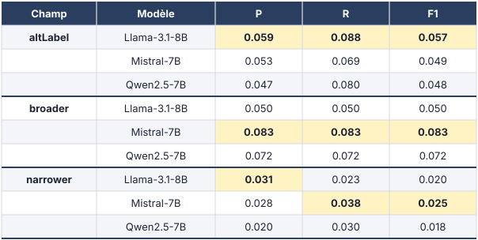

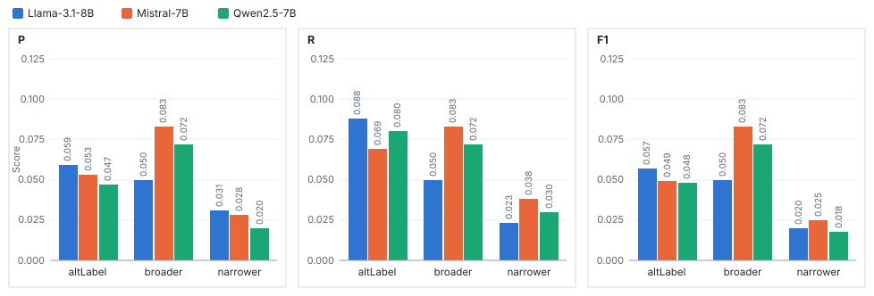

Le graphique ci-dessus présente un panneau par mesure (P, R, F1), avec les trois champs et les trois modèles. Meilleur F1 : Llama-3.1-8B pour `altLabel` (0,057), Mistral-7B pour `broader` (0,083) et Mistral-7B pour `narrower` (0,025). Ces valeurs basses viennent surtout de la comparaison mot à mot : un terme juste mais formulé autrement que dans la référence est compté comme faux.

**d. Précision, rappel et F1 : version soft**

Le tableau ci-dessous donne la précision, le rappel et le F1 en version soft (Fränti et Mariescu-Istodor, 2023), qui accepte un terme proche par le sens. Dans chaque champ, le meilleur score de chaque colonne est surligné. Les scores sont nettement plus élevés qu'en version crisp : pour `altLabel`, le F1 va de 0,048 à 0,057 en crisp, contre 0,5607 à 0,6233 en soft, selon le modèle.

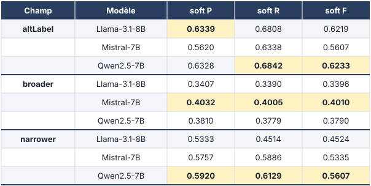

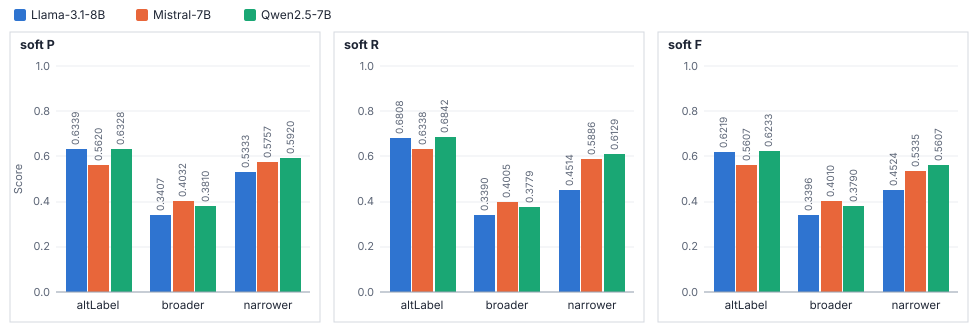

Le graphique ci-dessus présente un panneau par mesure (soft P, soft R, soft F), avec les trois champs et les trois modèles. Meilleur soft F : Qwen2.5-7B pour `altLabel` (0,6233), Mistral-7B pour `broader` (0,4010) et Qwen2.5-7B pour `narrower` (0,5607). L'écart avec la version crisp montre que beaucoup de termes prédits sont proches par le sens de la référence, sans en reprendre la forme exacte.

#### 6.1.4. Niveau 3 : DEMANDE et 3 briques

**a. Métriques d'entraînement**

Le tableau ci-dessous donne, pour chaque modèle et à chaque époque, la training loss, la validation loss, l'entropie, le nombre cumulé de tokens vus et la token accuracy moyenne. La cellule surlignée marque la validation loss minimale de chaque modèle : époque 2 pour les trois modèles. La plus basse est celle de Llama-3.1-8B (0,586285).

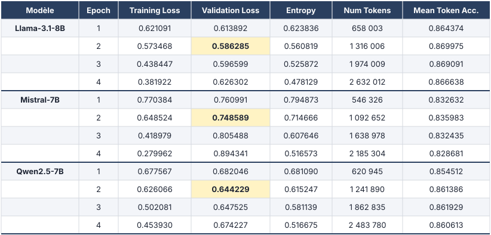

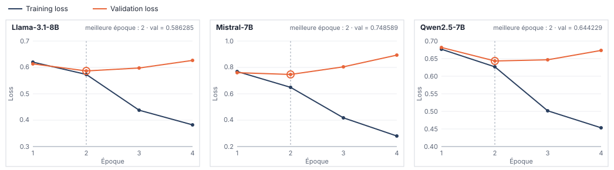

La figure ci-dessus présente un panneau par modèle : la training loss (pointillé) et la validation loss (trait plein) en fonction de l'époque, le cercle marquant la meilleure époque. La training loss baisse jusqu'à la dernière époque, alors que la validation loss remonte après la meilleure époque : au-delà, le modèle commence à surapprendre, et c'est donc le checkpoint de la meilleure époque qui est retenu.

**b. Similarité cosinus**

Le tableau ci-dessous donne la similarité cosinus moyenne entre la valeur prédite et la valeur de référence, pour chaque attribut, puis la moyenne des quatre attributs (dernière ligne). La meilleure valeur de chaque ligne est surlignée. En moyenne, Mistral-7B obtient le meilleur score (0,586).

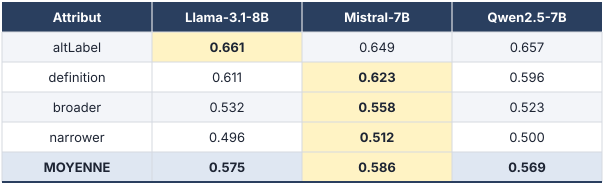

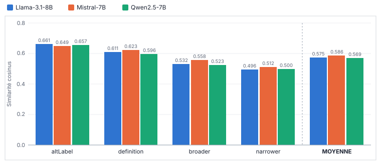

Le graphique ci-dessus reprend ces valeurs par attribut. L'attribut le mieux reproduit est `altLabel` (de 0,649 à 0,661 selon le modèle), le moins bien reproduit est `narrower` (de 0,496 à 0,512). Sur la moyenne, l'écart entre le meilleur et le moins bon modèle est de 0,017.

**c. Précision, rappel et F1 : version crisp**

Le tableau ci-dessous donne la précision (P), le rappel (R) et le F1 calculés en correspondance exacte, pour `altLabel`, `broader` et `narrower`. Dans chaque champ, le meilleur score de chaque colonne est surligné. Les scores restent bas : le F1 le plus élevé est 0,072 (`broader`, Mistral-7B). Pour `broader`, P, R et F1 sont identiques : le nombre de termes prédits est égal au nombre de termes attendus.

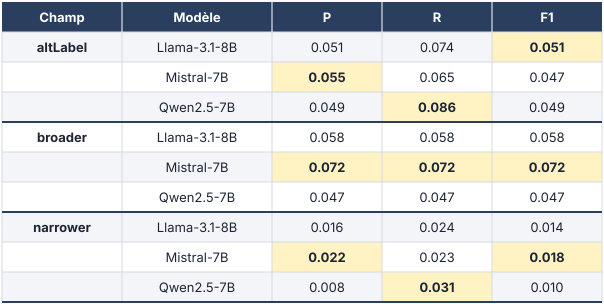

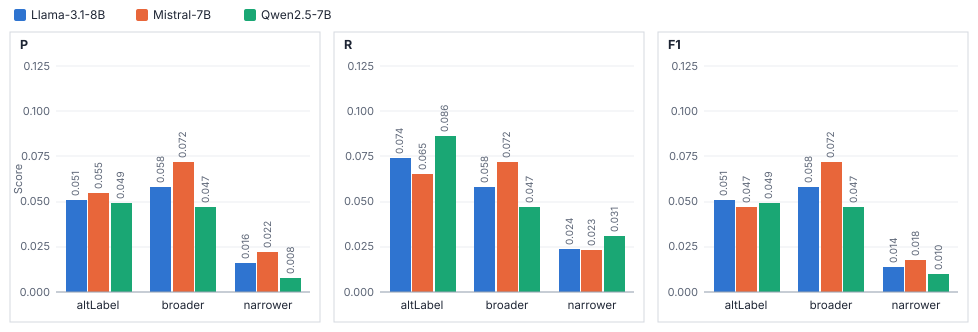

Le graphique ci-dessus présente un panneau par mesure (P, R, F1), avec les trois champs et les trois modèles. Meilleur F1 : Llama-3.1-8B pour `altLabel` (0,051), Mistral-7B pour `broader` (0,072) et Mistral-7B pour `narrower` (0,018). Ces valeurs basses viennent surtout de la comparaison mot à mot : un terme juste mais formulé autrement que dans la référence est compté comme faux.

**d. Précision, rappel et F1 : version soft**

Le tableau ci-dessous donne la précision, le rappel et le F1 en version soft (Fränti et Mariescu-Istodor, 2023), qui accepte un terme proche par le sens. Dans chaque champ, le meilleur score de chaque colonne est surligné. Les scores sont nettement plus élevés qu'en version crisp : pour `altLabel`, le F1 va de 0,047 à 0,051 en crisp, contre 0,5684 à 0,6424 en soft, selon le modèle.

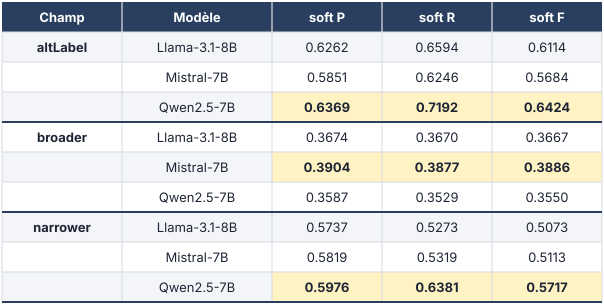

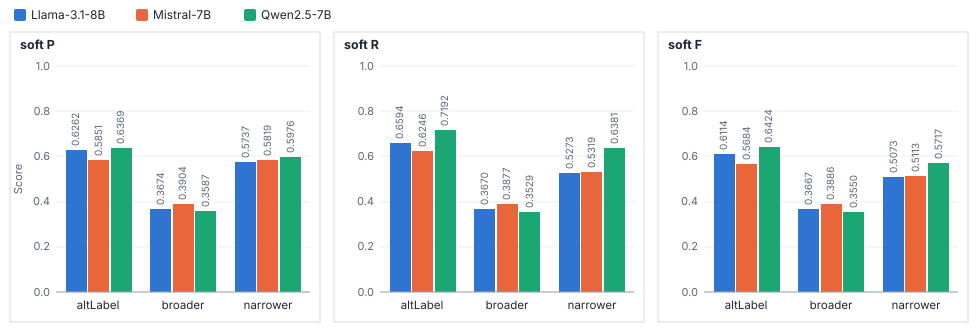

Le graphique ci-dessus présente un panneau par mesure (soft P, soft R, soft F), avec les trois champs et les trois modèles. Meilleur soft F : Qwen2.5-7B pour `altLabel` (0,6424), Mistral-7B pour `broader` (0,3886) et Qwen2.5-7B pour `narrower` (0,5717). L'écart avec la version crisp montre que beaucoup de termes prédits sont proches par le sens de la référence, sans en reprendre la forme exacte.

#### 6.1.5. Niveau 4 : DEMANDE et 4 briques

**a. Métriques d'entraînement**

Le tableau ci-dessous donne, pour chaque modèle et à chaque époque, la training loss, la validation loss, l'entropie, le nombre cumulé de tokens vus et la token accuracy moyenne. La cellule surlignée marque la validation loss minimale de chaque modèle : époque 3 pour Llama-3.1-8B, époque 2 pour Mistral-7B et époque 3 pour Qwen2.5-7B. La plus basse est celle de Llama-3.1-8B (0,5624).

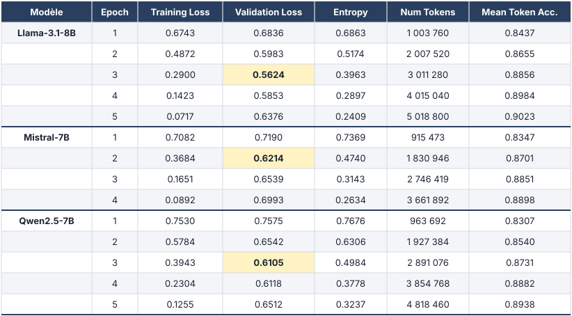

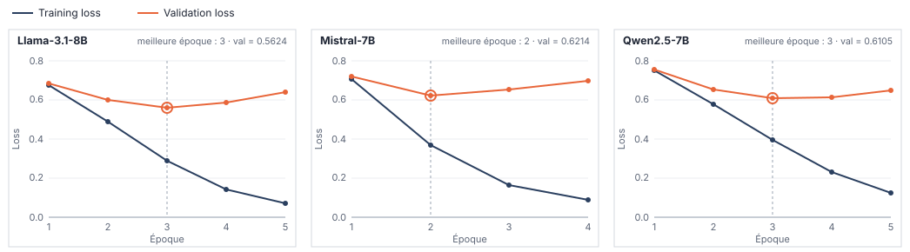

La figure ci-dessus présente un panneau par modèle : la training loss (pointillé) et la validation loss (trait plein) en fonction de l'époque, le cercle marquant la meilleure époque. La training loss baisse jusqu'à la dernière époque, alors que la validation loss remonte après la meilleure époque : au-delà, le modèle commence à surapprendre, et c'est donc le checkpoint de la meilleure époque qui est retenu.

**b. Similarité cosinus**

Le tableau ci-dessous donne la similarité cosinus moyenne entre la valeur prédite et la valeur de référence, pour chaque attribut, puis la moyenne des quatre attributs (dernière ligne). La meilleure valeur de chaque ligne est surlignée. En moyenne, Mistral-7B obtient le meilleur score (0,656).

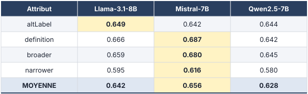

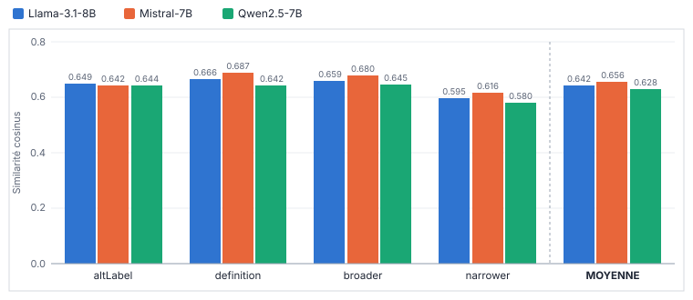

Le graphique ci-dessus reprend ces valeurs par attribut. L'attribut le mieux reproduit est `definition` (de 0,642 à 0,687 selon le modèle), le moins bien reproduit est `narrower` (de 0,580 à 0,616). Sur la moyenne, l'écart entre le meilleur et le moins bon modèle est de 0,028.

**c. Précision, rappel et F1 : version crisp**

Le tableau ci-dessous donne la précision (P), le rappel (R) et le F1 calculés en correspondance exacte, pour `altLabel`, `broader` et `narrower`. Dans chaque champ, le meilleur score de chaque colonne est surligné. Les scores restent bas : le F1 le plus élevé est 0,239 (`broader`, Mistral-7B). Pour `broader`, P, R et F1 sont identiques : le nombre de termes prédits est égal au nombre de termes attendus.

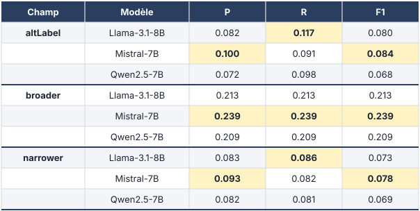

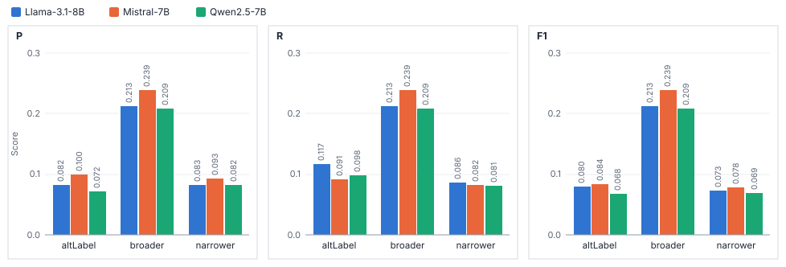

Le graphique ci-dessus présente un panneau par mesure (P, R, F1), avec les trois champs et les trois modèles. Meilleur F1 : Mistral-7B pour `altLabel` (0,084), Mistral-7B pour `broader` (0,239) et Mistral-7B pour `narrower` (0,078). Ces valeurs basses viennent surtout de la comparaison mot à mot : un terme juste mais formulé autrement que dans la référence est compté comme faux.

**d. Précision, rappel et F1 : version soft**

Le tableau ci-dessous donne la précision, le rappel et le F1 en version soft (Fränti et Mariescu-Istodor, 2023), qui accepte un terme proche par le sens. Dans chaque champ, le meilleur score de chaque colonne est surligné. Les scores sont nettement plus élevés qu'en version crisp : pour `altLabel`, le F1 va de 0,068 à 0,084 en crisp, contre 0,5630 à 0,5837 en soft, selon le modèle.

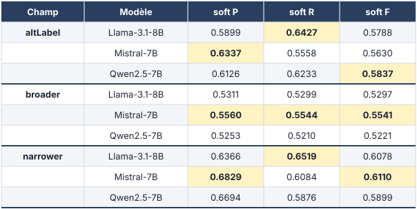

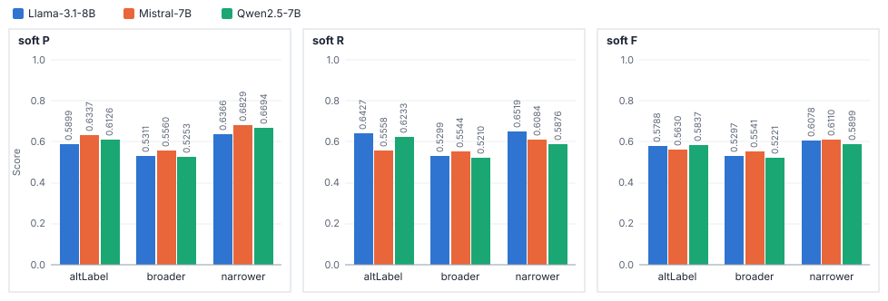

Le graphique ci-dessus présente un panneau par mesure (soft P, soft R, soft F), avec les trois champs et les trois modèles. Meilleur soft F : Qwen2.5-7B pour `altLabel` (0,5837), Mistral-7B pour `broader` (0,5541) et Mistral-7B pour `narrower` (0,6110). L'écart avec la version crisp montre que beaucoup de termes prédits sont proches par le sens de la référence, sans en reprendre la forme exacte.

#### 6.1.6. Niveau ALL : mélange des niveaux 0 à 4

**a. Métriques d'entraînement**

Le tableau ci-dessous donne, pour chaque modèle et à chaque époque, la training loss, la validation loss, l'entropie, le nombre cumulé de tokens vus et la token accuracy moyenne. La cellule surlignée marque la validation loss minimale de chaque modèle : époque 3 pour Llama-3.1-8B, époque 2 pour Mistral-7B et époque 3 pour Qwen2.5-7B. La plus basse est celle de Llama-3.1-8B (0,781160).

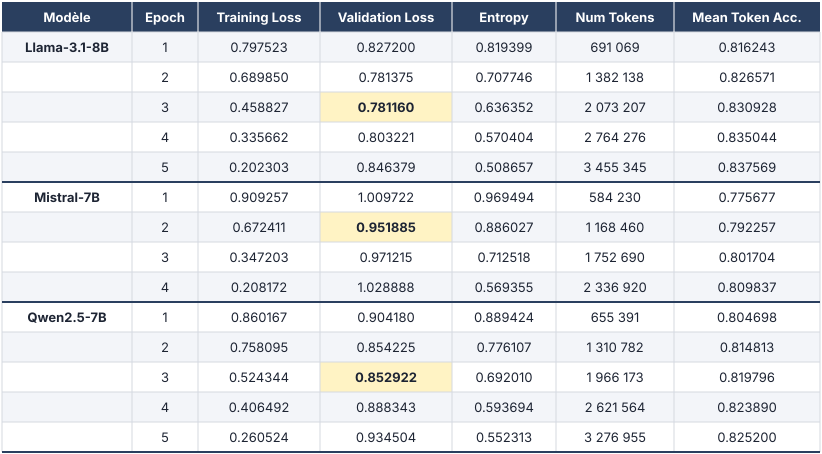

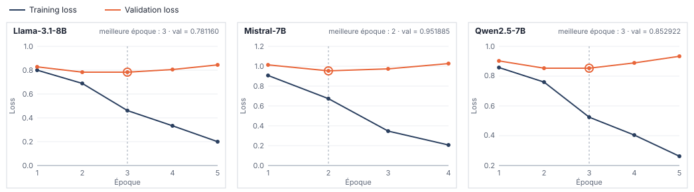

La figure ci-dessus présente un panneau par modèle : la training loss (pointillé) et la validation loss (trait plein) en fonction de l'époque, le cercle marquant la meilleure époque. La training loss baisse jusqu'à la dernière époque, alors que la validation loss remonte après la meilleure époque : au-delà, le modèle commence à surapprendre, et c'est donc le checkpoint de la meilleure époque qui est retenu.

**b. Similarité cosinus**

Le tableau ci-dessous donne la similarité cosinus moyenne entre la valeur prédite et la valeur de référence, pour chaque attribut, puis la moyenne des quatre attributs (dernière ligne). La meilleure valeur de chaque ligne est surlignée. En moyenne, Mistral-7B obtient le meilleur score (0,465).

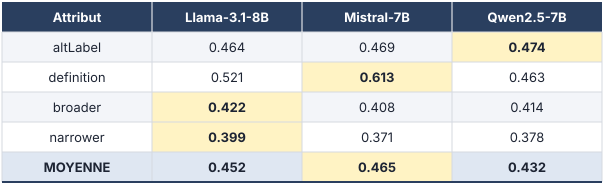


Le graphique ci-dessus reprend ces valeurs par attribut. L'attribut le mieux reproduit est `definition` (de 0,463 à 0,613 selon le modèle), le moins bien reproduit est `narrower` (de 0,371 à 0,399). Sur la moyenne, l'écart entre le meilleur et le moins bon modèle est de 0,033.

**c. Précision, rappel et F1 : version crisp**

Le tableau ci-dessous donne la précision (P), le rappel (R) et le F1 calculés en correspondance exacte, pour `altLabel`, `broader` et `narrower`. Dans chaque champ, le meilleur score de chaque colonne est surligné. Les scores restent bas : le F1 le plus élevé est 0,083 (`broader`, Llama-3.1-8B). Pour `broader`, P, R et F1 sont identiques : le nombre de termes prédits est égal au nombre de termes attendus.


Le graphique ci-dessus présente un panneau par mesure (P, R, F1), avec les trois champs et les trois modèles. Meilleur F1 : Mistral-7B et Qwen2.5-7B pour `altLabel` (0,044), Llama-3.1-8B pour `broader` (0,083) et Llama-3.1-8B pour `narrower` (0,015). Ces valeurs basses viennent surtout de la comparaison mot à mot : un terme juste mais formulé autrement que dans la référence est compté comme faux.

**d. Précision, rappel et F1 : version soft**

Le tableau ci-dessous donne la précision, le rappel et le F1 en version soft (Fränti et Mariescu-Istodor, 2023), qui accepte un terme proche par le sens. Dans chaque champ, le meilleur score de chaque colonne est surligné. Les scores sont nettement plus élevés qu'en version crisp : pour `altLabel`, le F1 va de 0,040 à 0,044 en crisp, contre 0,3968 à 0,4211 en soft, selon le modèle.


Le graphique ci-dessus présente un panneau par mesure (soft P, soft R, soft F), avec les trois champs et les trois modèles. Meilleur soft F : Mistral-7B pour `altLabel` (0,4211), Llama-3.1-8B pour `broader` (0,3122) et Llama-3.1-8B pour `narrower` (0,3968). L'écart avec la version crisp montre que beaucoup de termes prédits sont proches par le sens de la référence, sans en reprendre la forme exacte.

#### 6.1.7. Comparaison des niveaux

Synthèse des résultats des six niveaux, pour identifier le niveau de prompt qui donne les meilleurs concepts.

**Courbes de loss des trois modèles, niveau par niveau**

Trait plein : validation loss ; trait pointillé : training loss. Le cercle marque la meilleure époque (validation loss minimale) de chaque modèle.


Les courbes ont la même forme aux six niveaux : la validation loss atteint son minimum entre l'époque 2 et l'époque 3, puis remonte. La validation loss la plus basse est obtenue au niveau 4 par Llama-3.1-8B (0,5624).

### 6.2. Rattachement au thésaurus

Pour chaque niveau, les résultats comprennent les métriques d'entraînement et la similarité cosinus entre le titre prédit et le titre attendu (section 5.2).

#### 6.2.1. Niveau 0 : DEMANDE seule

**a. Métriques d'entraînement**

Le tableau ci-dessous regroupe, pour chaque modèle, le temps de fine-tuning, le nombre de tokens vus, puis à chaque époque la training loss, la validation loss, l'entropie et la token accuracy. La cellule surlignée marque la validation loss minimale : époque 4 pour Llama-3.1-8B, époque 3 pour Mistral-7B et époque 3 pour Qwen2.5-7B. La plus basse est celle de Mistral-7B (0,0635, token accuracy 0,9849). Qwen2.5-7B est le plus rapide à entraîner (3 h 45), Mistral-7B le plus lent (4 h 47).


La figure ci-dessus présente un panneau par modèle : la training loss (pointillé) et la validation loss (trait plein) en fonction de l'époque, le cercle marquant la meilleure époque. La training loss tend vers zéro, alors que la validation loss remonte après la meilleure époque : au-delà, le modèle surapprend, et c'est le checkpoint de la meilleure époque qui est retenu.

**b. Similarité cosinus**

Similarité globale et répartition (5731 requêtes)

Le tableau ci-dessous donne la similarité cosinus moyenne entre le titre de thésaurus prédit et le titre attendu, sur les 5731 requêtes de test (première ligne), puis la part des requêtes dans chaque tranche de similarité. La meilleure moyenne est surlignée : Llama-3.1-8B (0,911). Entre 77,0 % et 78,9 % des requêtes ont un score d'au moins 0,95, ce qui correspond au bon titre ou à un titre quasi identique.


Sur le graphique ci-dessus, à gauche, la similarité moyenne de chaque modèle ; à droite, la répartition des requêtes par tranche. La répartition est bimodale : la grande majorité des requêtes est au-dessus de 0,95, un second groupe (de 13,6 % à 14,9 %) est sous 0,70, ce qui correspond à un titre de sens différent, donc à un mauvais rattachement, et les tranches intermédiaires sont peu fournies (de 7,5 à 8,1 % au total).

Similarité selon la richesse

Le tableau ci-dessous donne la similarité cosinus moyenne selon la classe de richesse de la fiche de concept fournie en entrée (de 0 à 4 ; N est le nombre de requêtes de chaque classe). Le meilleur score de chaque ligne est surligné. La classe 0 (N=422) est la plus difficile pour les trois modèles (0,836, 0,791 et 0,816).


Le graphique ci-dessus montre que, pour les trois modèles, le score augmente de la classe 0 à la classe 3 : plus la fiche fournie en entrée est riche, plus le rattachement est juste ; la classe 3 donne les meilleurs scores. La classe 4 ne compte que 56 requêtes, son score est donc moins stable que celui des autres classes.

#### 6.2.2. Niveau 1 : DEMANDE et 1 brique

**a. Métriques d'entraînement**

Le tableau ci-dessous regroupe, pour chaque modèle, le temps de fine-tuning, le nombre de tokens vus, puis à chaque époque la training loss, la validation loss, l'entropie et la token accuracy. La cellule surlignée marque la validation loss minimale : époque 3 pour Llama-3.1-8B, époque 4 pour Mistral-7B et époque 3 pour Qwen2.5-7B. La plus basse est celle de Mistral-7B (0,0616, token accuracy 0,9860). Qwen2.5-7B est le plus rapide à entraîner (3 h 57), Mistral-7B le plus lent (4 h 32).


La figure ci-dessus présente un panneau par modèle : la training loss (pointillé) et la validation loss (trait plein) en fonction de l'époque, le cercle marquant la meilleure époque. La training loss tend vers zéro, alors que la validation loss remonte après la meilleure époque : au-delà, le modèle surapprend, et c'est le checkpoint de la meilleure époque qui est retenu.

**b. Similarité cosinus**

Similarité globale et répartition (5731 requêtes)

Le tableau ci-dessous donne la similarité cosinus moyenne entre le titre de thésaurus prédit et le titre attendu, sur les 5731 requêtes de test (première ligne), puis la part des requêtes dans chaque tranche de similarité. La meilleure moyenne est surlignée : Llama-3.1-8B et Mistral-7B (0,907). Entre 76,5 % et 78,7 % des requêtes ont un score d'au moins 0,95, ce qui correspond au bon titre ou à un titre quasi identique.


Sur le graphique ci-dessus, à gauche, la similarité moyenne de chaque modèle ; à droite, la répartition des requêtes par tranche. La répartition est bimodale : la grande majorité des requêtes est au-dessus de 0,95, un second groupe (de 14,2 % à 15,3 %) est sous 0,70, ce qui correspond à un titre de sens différent, donc à un mauvais rattachement, et les tranches intermédiaires sont peu fournies (de 7,0 à 8,2 % au total).

Similarité selon la richesse

Le tableau ci-dessous donne la similarité cosinus moyenne selon la classe de richesse de la fiche de concept fournie en entrée (de 0 à 4 ; N est le nombre de requêtes de chaque classe). Le meilleur score de chaque ligne est surligné. La classe 0 (N=422) est la plus difficile pour les trois modèles (0,826, 0,764 et 0,810).


Le graphique ci-dessus montre que, pour les trois modèles, le score augmente de la classe 0 à la classe 3 : plus la fiche fournie en entrée est riche, plus le rattachement est juste ; la classe 3 donne les meilleurs scores. La classe 4 ne compte que 56 requêtes, son score est donc moins stable que celui des autres classes.

#### 6.2.3. Niveau 2 : DEMANDE et 2 briques

**a. Métriques d'entraînement**

Le tableau ci-dessous regroupe, pour chaque modèle, le temps de fine-tuning, le nombre de tokens vus, puis à chaque époque la training loss, la validation loss, l'entropie et la token accuracy. La cellule surlignée marque la validation loss minimale : époque 4 pour Llama-3.1-8B, époque 4 pour Mistral-7B et époque 3 pour Qwen2.5-7B. La plus basse est celle de Mistral-7B (0,0595, token accuracy 0,9864). Qwen2.5-7B est le plus rapide à entraîner (4 h 17), Mistral-7B le plus lent (4 h 55).


La figure ci-dessus présente un panneau par modèle : la training loss (pointillé) et la validation loss (trait plein) en fonction de l'époque, le cercle marquant la meilleure époque. La training loss tend vers zéro, alors que la validation loss remonte après la meilleure époque : au-delà, le modèle surapprend, et c'est le checkpoint de la meilleure époque qui est retenu.

**b. Similarité cosinus**

Similarité globale et répartition (5731 requêtes)

Le tableau ci-dessous donne la similarité cosinus moyenne entre le titre de thésaurus prédit et le titre attendu, sur les 5731 requêtes de test (première ligne), puis la part des requêtes dans chaque tranche de similarité. La meilleure moyenne est surlignée : Mistral-7B (0,916). Entre 76,9 % et 80,4 % des requêtes ont un score d'au moins 0,95, ce qui correspond au bon titre ou à un titre quasi identique.


Sur le graphique ci-dessus, à gauche, la similarité moyenne de chaque modèle ; à droite, la répartition des requêtes par tranche. La répartition est bimodale : la grande majorité des requêtes est au-dessus de 0,95, un second groupe (de 12,8 % à 14,4 %) est sous 0,70, ce qui correspond à un titre de sens différent, donc à un mauvais rattachement, et les tranches intermédiaires sont peu fournies (de 6,8 à 8,7 % au total).

Similarité selon la richesse

Le tableau ci-dessous donne la similarité cosinus moyenne selon la classe de richesse de la fiche de concept fournie en entrée (de 0 à 4 ; N est le nombre de requêtes de chaque classe). Le meilleur score de chaque ligne est surligné. La classe 0 (N=422) est la plus difficile pour les trois modèles (0,848, 0,847 et 0,831).


Le graphique ci-dessus montre que, pour les trois modèles, le score augmente de la classe 0 à la classe 3 : plus la fiche fournie en entrée est riche, plus le rattachement est juste ; la classe 3 donne les meilleurs scores. La classe 4 ne compte que 56 requêtes, son score est donc moins stable que celui des autres classes.

#### 6.2.4. Niveau 3 : DEMANDE et 3 briques

**a. Métriques d'entraînement**

Le tableau ci-dessous regroupe, pour chaque modèle, le temps de fine-tuning, le nombre de tokens vus, puis à chaque époque la training loss, la validation loss, l'entropie et la token accuracy. La cellule surlignée marque la validation loss minimale : époque 3 pour les trois modèles. La plus basse est celle de Mistral-7B (0,0604, token accuracy 0,9852). Qwen2.5-7B est le plus rapide à entraîner (4 h 45), Mistral-7B le plus lent (5 h 27).


La figure ci-dessus présente un panneau par modèle : la training loss (pointillé) et la validation loss (trait plein) en fonction de l'époque, le cercle marquant la meilleure époque. La training loss tend vers zéro, alors que la validation loss remonte après la meilleure époque : au-delà, le modèle surapprend, et c'est le checkpoint de la meilleure époque qui est retenu.

**b. Similarité cosinus**

Similarité globale et répartition (5731 requêtes)

Le tableau ci-dessous donne la similarité cosinus moyenne entre le titre de thésaurus prédit et le titre attendu, sur les 5731 requêtes de test (première ligne), puis la part des requêtes dans chaque tranche de similarité. La meilleure moyenne est surlignée : Mistral-7B (0,910). Entre 76,7 % et 78,8 % des requêtes ont un score d'au moins 0,95, ce qui correspond au bon titre ou à un titre quasi identique.


Sur le graphique ci-dessus, à gauche, la similarité moyenne de chaque modèle ; à droite, la répartition des requêtes par tranche. La répartition est bimodale : la grande majorité des requêtes est au-dessus de 0,95, un second groupe (de 13,8 % à 15,3 %) est sous 0,70, ce qui correspond à un titre de sens différent, donc à un mauvais rattachement, et les tranches intermédiaires sont peu fournies (de 6,9 à 8,0 % au total).

Similarité selon la richesse

Le tableau ci-dessous donne la similarité cosinus moyenne selon la classe de richesse de la fiche de concept fournie en entrée (de 0 à 4 ; N est le nombre de requêtes de chaque classe). Le meilleur score de chaque ligne est surligné. La classe 0 (N=422) est la plus difficile pour les trois modèles (0,844, 0,829 et 0,804).


Le graphique ci-dessus montre que, pour les trois modèles, le score augmente de la classe 0 à la classe 3 : plus la fiche fournie en entrée est riche, plus le rattachement est juste ; la classe 3 donne les meilleurs scores. La classe 4 ne compte que 56 requêtes, son score est donc moins stable que celui des autres classes.

#### 6.2.5. Niveau 4 : DEMANDE et 4 briques

**a. Métriques d'entraînement**

Le tableau ci-dessous regroupe, pour chaque modèle, le temps de fine-tuning, le nombre de tokens vus, puis à chaque époque la training loss, la validation loss, l'entropie et la token accuracy. La cellule surlignée marque la validation loss minimale : époque 4 pour les trois modèles. La plus basse est celle de Mistral-7B (0,0597, token accuracy 0,9864). Qwen2.5-7B est le plus rapide à entraîner (6 h 47), Mistral-7B le plus lent (8 h 07).


La figure ci-dessus présente un panneau par modèle : la training loss (pointillé) et la validation loss (trait plein) en fonction de l'époque, le cercle marquant la meilleure époque. La training loss tend vers zéro, alors que la validation loss remonte après la meilleure époque : au-delà, le modèle surapprend, et c'est le checkpoint de la meilleure époque qui est retenu.

**b. Similarité cosinus**

Similarité globale et répartition (5731 requêtes)

Le tableau ci-dessous donne la similarité cosinus moyenne entre le titre de thésaurus prédit et le titre attendu, sur les 5731 requêtes de test (première ligne), puis la part des requêtes dans chaque tranche de similarité. La meilleure moyenne est surlignée : Mistral-7B (0,917). Entre 78,2 % et 80,7 % des requêtes ont un score d'au moins 0,95, ce qui correspond au bon titre ou à un titre quasi identique.


Sur le graphique ci-dessus, à gauche, la similarité moyenne de chaque modèle ; à droite, la répartition des requêtes par tranche. La répartition est bimodale : la grande majorité des requêtes est au-dessus de 0,95, un second groupe (de 12,5 % à 14,3 %) est sous 0,70, ce qui correspond à un titre de sens différent, donc à un mauvais rattachement, et les tranches intermédiaires sont peu fournies (de 6,7 à 7,5 % au total).

Similarité selon la richesse

Le tableau ci-dessous donne la similarité cosinus moyenne selon la classe de richesse de la fiche de concept fournie en entrée (de 0 à 4 ; N est le nombre de requêtes de chaque classe). Le meilleur score de chaque ligne est surligné. La classe 0 (N=422) est la plus difficile pour les trois modèles (0,841, 0,823 et 0,793).


Le graphique ci-dessus montre que, pour les trois modèles, le score augmente de la classe 0 à la classe 3 : plus la fiche fournie en entrée est riche, plus le rattachement est juste ; la classe 3 donne les meilleurs scores. La classe 4 ne compte que 56 requêtes, son score est donc moins stable que celui des autres classes.

#### 6.2.6. Niveau ALL : mélange des niveaux 0 à 4

**a. Métriques d'entraînement**

Le tableau ci-dessous regroupe, pour chaque modèle, le temps de fine-tuning, le nombre de tokens vus, puis à chaque époque la training loss, la validation loss, l'entropie et la token accuracy. La cellule surlignée marque la validation loss minimale : époque 3 pour les trois modèles. La plus basse est celle de Mistral-7B (0,0605, token accuracy 0,9848). Qwen2.5-7B est le plus rapide à entraîner (3 h 31), Mistral-7B le plus lent (4 h 01).


La figure ci-dessus présente un panneau par modèle : la training loss (pointillé) et la validation loss (trait plein) en fonction de l'époque, le cercle marquant la meilleure époque. La training loss tend vers zéro, alors que la validation loss remonte après la meilleure époque : au-delà, le modèle surapprend, et c'est le checkpoint de la meilleure époque qui est retenu.

**b. Similarité cosinus**

Similarité globale et répartition (5731 requêtes)

Le tableau ci-dessous donne la similarité cosinus moyenne entre le titre de thésaurus prédit et le titre attendu, sur les 5731 requêtes de test (première ligne), puis la part des requêtes dans chaque tranche de similarité. La meilleure moyenne est surlignée : Mistral-7B (0,904). Entre 74,8 % et 77,2 % des requêtes ont un score d'au moins 0,95, ce qui correspond au bon titre ou à un titre quasi identique.


Sur le graphique ci-dessus, à gauche, la similarité moyenne de chaque modèle ; à droite, la répartition des requêtes par tranche. La répartition est bimodale : la grande majorité des requêtes est au-dessus de 0,95, un second groupe (de 14,7 % à 16,4 %) est sous 0,70, ce qui correspond à un titre de sens différent, donc à un mauvais rattachement, et les tranches intermédiaires sont peu fournies (de 8,1 à 8,8 % au total).

Similarité selon la richesse

Le tableau ci-dessous donne la similarité cosinus moyenne selon la classe de richesse de la fiche de concept fournie en entrée (de 0 à 4 ; N est le nombre de requêtes de chaque classe). Le meilleur score de chaque ligne est surligné. La classe 0 (N=422) est la plus difficile pour les trois modèles (0,816, 0,830 et 0,795).


Le graphique ci-dessus montre que, pour les trois modèles, le score augmente de la classe 0 à la classe 3 : plus la fiche fournie en entrée est riche, plus le rattachement est juste ; la classe 3 donne les meilleurs scores. La classe 4 ne compte que 56 requêtes, son score est donc moins stable que celui des autres classes.

#### 6.2.7. Comparaison des niveaux

Synthèse des résultats des six niveaux, pour identifier le niveau de prompt qui donne le meilleur rattachement.

**Courbes de loss des trois modèles, niveau par niveau**

Trait plein : validation loss ; trait pointillé : training loss. Le cercle marque la meilleure époque (validation loss minimale) de chaque modèle.


Les courbes ont la même forme aux six niveaux : la validation loss atteint son minimum entre l'époque 3 et l'époque 4, puis remonte. La validation loss la plus basse est obtenue au niveau 2 par Mistral-7B (0,0595).

### 6.3. Comparaison des modèles

Comparaison de Llama 3.1, Mistral et Qwen 2.5 sur les deux tâches, pour désigner le modèle et le niveau de prompt à retenir.

Cette section reprend les résultats des sections 6.1 et 6.2 et compare les trois modèles niveau par niveau. Les deux tâches sont présentées séparément, car elles ne sont pas évaluées avec les mêmes métriques : la génération de concepts est comparée sur l'entraînement, la similarité cosinus, le crisp et le soft ; le rattachement au thésaurus sur l'entraînement et la similarité cosinus (le crisp et le soft ne s'appliquent pas, section 5.2). Chaque tableau donne les valeurs des trois modèles à chaque niveau ; la meilleure valeur de chaque ligne est surlignée en jaune et la dernière colonne indique le modèle gagnant. La dernière ligne compte le nombre de métriques gagnées par chaque modèle, comme dans la comparaison du RAG hybride. En cas d'égalité, la métrique est comptée pour chacun des modèles concernés.

#### 6.3.1. Génération de concepts

**a. Entraînement**

Le tableau suivant donne, pour chaque modèle et chaque niveau, la validation loss minimale et la token accuracy à la meilleure époque.


Llama-3.1-8B gagne les 12 métriques d'entraînement : il a la validation loss la plus basse et la meilleure token accuracy à tous les niveaux. Sa validation loss diminue régulièrement du niveau 0 au niveau 4 (de 0,790 à 0,562) : plus la consigne est riche, mieux le modèle prédit la réponse attendue. Le niveau ALL remonte à 0,781, presque au niveau de la question nue. Mistral-7B a la loss la plus élevée à tous les niveaux (de 1,197 au niveau 0 à 0,621 au niveau 4), mais l'écart avec Llama se resserre nettement au niveau 4. Une loss plus basse ne garantit pas pour autant de meilleures sorties : Llama ne gagne que 8 des 30 métriques de similarité (tableau b).

**b. Similarité cosinus**

Le tableau suivant donne la similarité cosinus de chaque attribut et la similarité moyenne, pour chaque modèle et chaque niveau.


Mistral-7B gagne 17 des 30 métriques de similarité, Llama-3.1-8B 8 et Qwen2.5-7B 7. Mistral est en tête sur la similarité moyenne à quatre niveaux sur six, dont le niveau 4, qui donne la meilleure valeur de toutes les expériences (0,656) ; il domine surtout `definition` et `broader`. L'écart entre modèles reste faible à chaque niveau (au plus 0,045 sur la moyenne), alors que l'écart entre niveaux est bien plus grand (de 0,465 au niveau ALL à 0,656 au niveau 4) : pour la génération de concepts, le niveau de prompt compte davantage que le choix du modèle. Seule exception notable : la `definition` de Mistral au niveau 2 (0,398), nettement en dessous des deux autres modèles.

**c. Précision, rappel et F1 : version crisp**

Le tableau suivant donne le F1 crisp de chaque champ, pour chaque modèle et chaque niveau.


Mistral-7B obtient 11 des meilleurs F1 crisp, Llama-3.1-8B 8 et Qwen2.5-7B 1. Llama est le plus souvent en tête sur `altLabel` (niveaux 0 à 3), Mistral sur `broader` et `narrower`. Au niveau 4, Mistral gagne les trois champs, et le F1 sur `broader` atteint 0,209 à 0,239 selon le modèle, soit près de trois fois plus qu'aux autres niveaux (0,086 au mieux). Ailleurs, les valeurs restent très basses : la correspondance exacte retrouve rarement la forme précise des termes de référence.

**d. Précision, rappel et F1 : version soft**

Le tableau suivant donne le soft F de chaque champ, pour chaque modèle et chaque niveau.


En version soft, Qwen2.5-7B obtient 9 des meilleurs scores, Mistral-7B 7 et Llama-3.1-8B 2. Qwen domine `altLabel` (niveaux 0 à 4) et `narrower` (niveaux 0 à 3), Mistral domine `broader` (niveaux 0 à 4). Le niveau 4 fait nettement progresser `broader` (0,554 contre 0,403 au mieux ailleurs) et `narrower` (0,611). `altLabel` est le seul champ où le niveau 4 n'est pas le meilleur (0,584 contre 0,647 au niveau 0). L'écart avec la version crisp confirme que les termes générés sont souvent justes par le sens, sans reprendre la forme exacte de la référence.

**e. Décompte des métriques gagnées**

Le tableau suivant compte, pour chaque catégorie de métriques, le nombre de fois où chaque modèle obtient le meilleur score, sur les six niveaux.


Sur les 78 métriques comparées, Mistral-7B en gagne 35, Llama-3.1-8B 30 et Qwen2.5-7B 17 (le total dépasse 78 à cause de quatre égalités). Chaque modèle a son point fort : Llama-3.1-8B apprend le mieux (il gagne toutes les métriques d'entraînement), Qwen2.5-7B génère les meilleurs synonymes et spécifiques au sens du soft, et Mistral-7B est le plus régulier, en tête en similarité et en crisp, et le meilleur sur presque tous les champs au niveau 4.

**f. Niveau de prompt à retenir**

Le tableau suivant donne la meilleure valeur obtenue à chaque niveau, tous modèles confondus, pour les métriques qui séparent le plus les niveaux.


Le niveau 4 est le meilleur sur les cinq métriques. Le niveau ALL est le plus faible en similarité et en soft : mélanger les formulations rend le modèle plus robuste à la manière de poser la question, mais il apprend moins bien la tâche elle-même. Pour la génération de concepts, le choix retenu est donc **Mistral-7B au niveau 4**.

#### 6.3.2. Rattachement au thésaurus

Pour cette tâche, la sortie est un seul titre de thésaurus : la comparaison porte donc sur l'entraînement et sur la similarité cosinus, le crisp et le soft n'étant pas utilisés (section 5.2).

**a. Entraînement**

Le tableau suivant donne, pour chaque modèle et chaque niveau, la validation loss minimale, la token accuracy à la meilleure époque et le temps total de fine-tuning.


Mistral-7B gagne les 12 métriques de qualité d'entraînement : la validation loss la plus basse et la meilleure token accuracy aux six niveaux. C'est aussi le plus lent à entraîner, et Qwen2.5-7B est toujours le plus rapide (les 6 métriques de temps). Les valeurs de loss sont très proches d'un modèle et d'un niveau à l'autre (de 0,0595 à 0,0693) et bien plus basses qu'en génération de concepts, car la réponse est courte et prise dans une liste fermée de titres. Le niveau 4 est le plus coûteux : ses prompts sont les plus longs, et l'entraînement y dure de 6 h 47 (Qwen) à 8 h 07 (Mistral), contre 4 h 17 à 4 h 55 au niveau 2.

**b. Similarité cosinus**

Le tableau suivant donne, pour chaque modèle et chaque niveau, la similarité moyenne sur les 5 731 requêtes de test, la part des requêtes avec un titre quasi identique (≥ 0,95), la part des requêtes mal rattachées (< 0,70, la plus basse étant la meilleure) et la similarité pour la classe de richesse 0 (422 requêtes, concept réduit à son prefLabel).


Mistral-7B gagne 16 des 24 métriques de similarité et Llama-3.1-8B 10 ; Qwen2.5-7B n'en gagne aucune. Mistral obtient la meilleure similarité moyenne à cinq niveaux sur six (dont une égalité avec Llama au niveau 1), et le niveau 4 donne les meilleurs résultats (0,917 et 80,7 % de titres quasi identiques), suivi de près par le niveau 2 (0,916). Les écarts entre niveaux restent faibles (de 0,895 à 0,917) : contrairement à la génération de concepts, le rattachement dépend peu de la formulation du prompt. Quel que soit le modèle ou le niveau, environ une requête sur sept reste mal rattachée.

**c. Concepts les plus pauvres (classe 0)**

La ligne « Classe 0 » du tableau précédent montre que, sur les concepts les plus pauvres, Llama-3.1-8B est le meilleur à cinq niveaux sur six (de 0,826 à 0,848). L'avantage de Mistral-7B en moyenne vient donc des concepts plus riches. Ce point compte en usage réel, puisque la plupart des concepts d'Opentheso sont incomplets.

**d. Décompte des métriques gagnées**


Sur les 42 métriques comparées, Mistral-7B en gagne 28, Llama-3.1-8B 10 et Qwen2.5-7B 6 (le total dépasse 42 à cause de deux égalités au niveau 1). Mistral-7B gagne le plus de métriques, Llama-3.1-8B est le plus fiable sur les concepts pauvres et Qwen2.5-7B le plus économique à entraîner. Pour le rattachement, le choix retenu est **Mistral-7B au niveau 4**, qui donne le meilleur score et garde le même format de prompt que la génération de concepts ; le niveau 2 est une alternative presque équivalente (0,916) et nettement moins longue à entraîner (4 h 55 contre 8 h 07 pour Mistral).

#### 6.3.3. Synthèse


## 7. Conclusion

Cette page a présenté l'approche par fine-tuning pour la génération de concepts et le rattachement au thésaurus. Deux adaptateurs LoRA ont été entraînés séparément, un par tâche, sur des paires question / réponse construites à partir de l'API Opentheso, avec six niveaux de prompt (niveaux 0 à 4 et niveau ALL) et trois modèles de base (Llama-3.1-8B, Mistral-7B et Qwen2.5-7B).

**Ce qu'il faut retenir**

- **Deux tâches de difficulté très différente** : le rattachement au thésaurus est bien appris (similarité moyenne de 0,904 à 0,917, et environ 78 % de titres quasi identiques), alors que la génération de concepts reste difficile (similarité moyenne de 0,465 à 0,656).
- **Le niveau de prompt compte plus que le modèle en génération** : à un niveau donné, les trois modèles sont proches (écart d'au plus 0,045), alors que le niveau 4 améliore nettement tous les scores, en particulier `broader` (F1 crisp 0,239, soft F 0,554). En rattachement, au contraire, le niveau change peu les résultats.
- **Le niveau ALL n'apporte pas de gain** : mélanger les formulations donne les plus faibles scores en génération de concepts (similarité moyenne 0,465) et un résultat légèrement inférieur aux autres niveaux en rattachement (0,904).
- **Le crisp sous-estime la qualité des sorties** : les F1 crisp restent presque toujours sous 0,09, alors que les soft F se situent entre 0,31 et 0,65. Les termes générés sont souvent justes par le sens sans reprendre la forme exacte de la référence, d'où l'intérêt d'évaluer les deux versions.
- **Mistral-7B est le modèle le plus régulier** : il gagne 35 des 78 métriques comparées en génération et 28 des 42 en rattachement, et il est le meilleur au niveau 4 sur les deux tâches. Il est retenu, au niveau 4, pour les deux modèles affinés.
- **Une validation loss basse ne suffit pas pour choisir un modèle** : Llama-3.1-8B a la loss la plus basse en génération de concepts, mais pas les meilleures sorties. Le choix se fait donc sur les métriques du jeu de test.

**Limites**

- Le niveau 4 de la génération de concepts utilise une extraction plus récente d'Opentheso (2 698 concepts, découpage 70 / 10 / 10 / 10 avec une réserve d'exemples) : sa comparaison avec les autres niveaux reste donc indicative.
- Le rattachement est évalué uniquement par la similarité cosinus : un titre proche mais différent peut obtenir un score élevé. Un taux de bonnes réponses exactes (même identifiant de thésaurus) compléterait cette mesure.
- Environ une requête sur sept reste mal rattachée, et les concepts réduits à leur prefLabel sont nettement moins bien traités, dans les deux tâches.
- La validation par le spécialiste (section 5.3) n'a pas encore été menée à grande échelle : les métriques ne disent pas si une définition ou une relation hiérarchique est réellement utilisable.

**Prochaine étape**

Combiner les modèles fine-tunés (Mistral-7B, niveau 4) avec le RAG hybride, qui fournit au modèle les exemples et les relations les plus proches, puis comparer les trois configurations (fine-tuning seul, RAG hybride seul, RAG hybride + fine-tuning) sur les mêmes jeux de test. À titre indicatif, le fine-tuning fait déjà mieux que le RAG hybride avec un LLM de base, surtout en rattachement (0,917 contre 0,732 pour le meilleur modèle du RAG hybride), mais les jeux de test ne sont pas identiques. Cette comparaison est développée dans la page [***Fine-tuning vs RAG hybride : comparaison et approches combinées***](Fine-tuning%20vs%20RAG%20hybride%20comparaison%20et%20approche%20402d3be13e588084975ec6c4cbee7ca9.md).